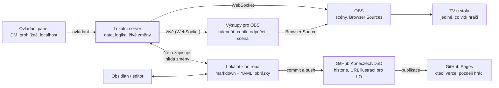

# DM Hub — zadání

> **Toto je master zadání.** Platí tento soubor v repu. Claude Doc „DM Hub — zadání“ je od 2. 10. 2026 jen archiv.
> Změny zadání se dělají v tomto souboru přes pull request, aby byly vidět v historii.

Stav k 2. 10. 2026 · autor: Matěj (DM)

## Účel a kontext

DM Hub je lokální ovládací panel pro DM, který pod jedno okno spojí nástroje kampaně a ovládá vše, co hráči vidí přes OBS. Hráči Hub nevidí, jejich jediným výstupem je TV u stolu.

Kampaň: D&D 5e (pravidla 2024, SRD 5.2.1), severní Mečové pobřeží, 1491 DR, čtyři hráči u fyzického stolu.

**Výchozí stav k 2. 10. 2026 — nástroje žijí odděleně a data na pěti místech:**

| Oblast | Co existuje | Kde žijí data dnes |
| --- | --- | --- |
| Kalendář Harptos | `kalendar.html` (editor, malý medailon, velký orloj), datový motor Harptos s testy v Node.js, události veřejné/skryté a vícedenní, lhůty k událostem | `kalendar-data.js` jen v lokálním klonu, v `.gitignore` kvůli skrytým událostem |
| Obchody | `polozky.json` (231 položek), `generator.html`, `cenik.html` | lokální klon, na GitHubu nejsou |
| OBS | `odpocet.html`, scény na numpadu, pozadí lokací, carousel iniciativy | lokální klon, na GitHubu nejsou |
| Souboje | Improved Initiative (Epic), vlastní CSS carousel, statbloky v JSON, 330 bytostí v knihovně | IIO; vlastní ilustrace 9 bytostí v `monsters/` na GitHubu |
| Ilustrace | ChatGPT 1536×1024 → Affinity 1920×1080, `prompty.md`, `pripravit_ilustraci.py` | GitHub bez jednotné konvence: portréty postav v kořeni repa, NPC Torva a Malk Orren v `monsters/`, scéna v `Places/Mirabar/` |
| Kánon | Lazy RPG Campaign Planner: Campaign Database, Characters, Registr rozhodnutí, Hrací kánon, zápisy sezení | Notion |
| Postavy | Dotazník k postavě (odpovědi hráčů), karty postav, překladový klíč | Google formulář (xlsx), Claude projekt |

Problém: stejná entita existuje v několika kopiích (Tusker v Notionu, v JSON pro IIO, jako ilustrace v kořeni repa, v dotazníku a v Claude projektu), soubory nemají jednotnou konvenci a u stolu se žongluje mezi samostatnými okny.

Verze 1 převede do repa kánon, kalendář, obchody, postavy a ilustrace míst. Duplicita se statbloky v IIO zůstane až do exportu ve verzi 2.

## Potvrzená rozhodnutí

Rozhodnutí 1–12 potvrdil DM 2. 10. 2026. Rozhodnutí 13–24 vzešla z první oponentury zadání, 25–32 z oponentury postupu výroby; DM je přijal týž den. Rozhodnutí 39–42 potvrdil DM 3. 10. 2026 (akceptace Bloku 1b a start Bloku 2). Rozhodnutí 33–38 potvrdil DM 2. 10. 2026 při kontrole ⚠ návrhů Bloku 0. Rozhodnutí 55–64 (světla a zvuk) potvrdil DM 10. 10. 2026, rozhodnutí 65 (audit UI) 11. 10. 2026, rozhodnutí 69–72 (mapa kánonu, hráčská stránka) 19. 10. 2026, rozhodnutí 73 (kánon jako wiki s editorem) 20. 10. 2026, rozhodnutí 74 (typové stránky wiki) a 75 (odkrývání textu karty) 21. 10. 2026; tehdy potvrdil i všechny návrhy z Otevřených bodů (tabulka Potvrzené návrhy níže); podobu přepínače Řídit světla (59) a zvukových výstupů s BT reproduktorem (62) navrhl Claude a ověří ji akceptace Bloků 4 a 5. Nepotvrzené návrhy jsou výslovně označené a shrnuté v Otevřených bodech.

| # | Rozhodnutí | Důsledek |
| --- | --- | --- |
| 1 | Kánon kampaně opouští Notion, žije jako markdown + YAML v Git repu | Hub, Claude i Obsidian čtou stejné soubory. Šablona Lazy RPG se replikuje složkami |
| 2 | Jedno veřejné repo `Koneczech/DnD`, nic se neskrývá | Příznak veřejné/skryté řídí jen zobrazení, ne zabezpečení. Platí i pro dotazníky hráčů |
| 3 | Lokální Hub u stolu + statická verze na GitHub Pages pro čtení | Lokální server je páteř; Pages je jen čtecí výstup |
| 4 | Hub je jen ovládací panel DM; hráči vidí vše přes OBS | Každý výstup pro hráče = Browser Source servírovaný Hubem |
| 5 | Verze 1 = živý panel pro sezení, verze 2 = příprava | Pořadí bloků 0, 1a, 1b, 2, 4 (světla), 5 (zvuk), 3, pak příprava (změna 10. 10. 2026) |
| 6 | Improved Initiative zůstává trackerem i knihovnou nestvůr | Vlastní modul iniciativy se nedělá |
| 7 | Vlastní bytosti, NPC a postavy žijí v repu, Hub je exportuje do IIO | Export patří do verze 2 (příprava); import do IIO zůstává ruční |
| 8 | Hráčská stránka na GitHub Pages až ve výhledu | Datový model s ní počítá od začátku (příznak veřejné/skryté u všech entit). Čtecí verze pro DM i hráčská stránka jsou veřejné, hráčská stránka je filtr, ne ochrana |
| 9 | Odpočet slouží výhradně k začátku sezení | Žádné dílky ani časovač na rozhodování |
| 10 | Skryté/odkryté = celé ilustrace, ne vrstvy | Ilustrace se stopou k zápletce se ve slideshow nezobrazí, dokud ji DM neodkryje |
| 11 | Další den nic nesleduje, jen připomíná | Žádné sledování pozic kouzel, podob ani BV |
| 12 | Scéna má tři složky: obraz, světla a zvuk (změna 10. 10. 2026) | Hub ovládá světla (Hue, WiZ) a pouští hudbu na TV a ambient se zvukovými efekty u stolu. Pocket Bard zůstává inspirací pro přepínače (stavy, intenzita). Dřívější „Hub nepřehrává zvuk ani hudbu“ neplatí |
| 13 | Tajné hodnoty (heslo OBS WebSocketu, případný API klíč) žijí jen v `hub/.env` mimo Git | Zadávají se v panelu na obrazovce Nastavení; v repu je jen vzor `hub/.env.example` |
| 14 | Entita = složka `<typ>/<id>/` s hlavním souborem `<id>.md` a vlastními obrázky | Jedna konvence pro všechny typy; funguje v Hubu, Obsidianu i na GitHubu |
| 15 | Vazby se zapisují jako odkazy Obsidianu `[[id]]` | Proklikávání a graf v Obsidianu i v Hubu bez převodu |
| 16 | Repo je jediný zdroj pravdy | Notion, Claude projekt a dotazník jsou po převodu jen archiv |
| 17 | Sezení má životní cyklus Zahájit / Ukončit | Hub zakládá soubor sezení, poznámky mají kam padat, uložení do GitHubu je jedno tlačítko |
| 18 | Existující soubory se přesouvají až s modulem, který je převezme, v jednom commitu se všemi odkazy | Blok 0 nic nepřesouvá; OBS ani IIO se přesunem nerozbijí |
| 19 | Data kalendáře se commitují do repa | Ruší `.gitignore` u `kalendar-data.js`; skryté události budou na GitHubu čitelné v souladu s rozhodnutím 2 |
| 20 | Samostatný kalendář se od začátku Bloku 1b dál nevyvíjí | Velký orloj a banner vznikají rovnou jako výstupy Hubu |
| 21 | Technologie: Node.js (LTS), panel i výstupy bez build kroku | Jeden jazyk pro server, panel i výstupy; převezme datový motor Harptos i s testy |
| 22 | Pojmy: Odpočet = začátek sezení, Lhůty = odpočty k událostem v kalendáři | Žádná záměna v panelu ani v kódu |
| 23 | Herní termíny podle českého PHB 2024 a `prekladovy-klic-cz.md` | Důkladný odpočinek, kostky obnovy, body výdrže (BV) |
| 24 | Ilustrace se v Hubu připravují poloautomaticky: prompt z entity → ChatGPT → import s automatickou úpravou | Blok 2 má ilustrační dílnu; přímé generování přes API je otevřený bod |
| 25 | Master zadání je `ZADANI.md` v repu | Claude Doc je archiv. Změny zadání jdou přes PR |
| 26 | Pravidla pro práci Claude Code jsou v `CLAUDE.md` v kořeni repa | Co zadání neřeší a má vliv na data, chování nebo UI, je v PR označené ⚠ návrh a přidané do Otevřených bodů. Interní detaily kódu rozhoduje Claude sám |
| 27 | Každý blok se vyvíjí ve vlastní větvi (`blok-0`, `blok-1a` …) a slučuje se přes pull request | PR je místo kontroly všech ⚠ návrhů |
| 28 | Testy běží v GitHub Actions na `ubuntu-latest` i `windows-latest` | Rozdíly Windows (zámky souborů, hlídání souborů, cesty) se odhalí před akceptací doma |
| 29 | Verze Node.js je na jednom místě: `.nvmrc`; `engines` v `hub/package.json` musí sedět | CI čte verzi z `.nvmrc` a při neshodě s `engines` selže |
| 30 | Konce řádků jsou v repu vždy LF (`.gitattributes`: `* text=auto eol=lf`) | Testy porovnávající obsah souborů se na Windows chovají stejně jako na Linuxu |
| 31 | Git hook je krátký shell skript, logika je v Node.js (`hub/hooks/pre-commit.js`) | Git na Windows spouští hooky přes svůj `sh`; logika se testuje na obou systémech |
| 32 | Lokální klon repa nesmí ležet v OneDrive | OneDrive soubory zamyká a hlídání souborů hlásí falešné změny. Hub to při startu ověří a upozorní |
| 33 | Název kampaně: „Limba: Rok kamenné borovice“ | Uložen v `kampan/kampan.yaml` |
| 34 | Výchozí port Hubu je 7420, jen localhost | Změna jde v Nastavení |
| 35 | Odložené zápisy přežijí pád serveru | Žurnál v `hub/.stav/odlozene-zapisy/` (mimo Git). Po startu se dokončí; novější soubor na disku má přednost a záznam se zahodí |
| 36 | Nastavení se ukládá tlačítkem Uložit nastavení | Výjimka z autosave: rozepsané heslo se neposílá po písmenech |
| 37 | Pilotní místo Bloku 2 je tábor lupičů kousek od Longsaddle | Celé příští sezení je bojové v tomto táboře |
| 38 | Počasí: déšť, sníh, mlha. Intenzita: tři úrovně | Rozsah efektů Bloku 2 |
| 39 | Pole `lhuta` u události kalendáře | Počet dní předem (1–999), kdy se událost ukazuje v OBS; starší pole `odpocet` z `kalendar-data.js` importér převede |
| 40 | Poznámky a sezení nesou datum v Harptosu | Poznámka `- 18:05 (19. Eleint) — text`; hlavička sezení `harptos_zacatek` a `harptos_konec` |
| 41 | Ilustrace míst a OBS pozadí patří do repa | Z `src/` se přesunou s Blokem 2; v repu jsou veřejné včetně skrytých ilustrací (rozhodnutí 2) |
| 42 | Ilustrace zatím vznikají ručně přes ChatGPT | Dílna připraví prompt a zpracuje obrázek; přímé generování přes API je cíl do budoucna (otevřený bod 1) |
| 43 | Obrazovka **U stolu** nahrazuje Scény OBS, Odpočet a Obchody | Dlaždice scén s ovládáním podle role scény: Start (odpočet), Místo, Obchod, Souboj. Místa zůstávají jako samostatná obrazovka **Místa** ve skupině Příprava (ne živé ovládání) |
| 44 | Role scén v OBS jsou na jednom místě | Tabulka Role scén dole na U stolu: Start, Místo, Obchod, Souboj a „po doběhnutí odpočtu“. Zmizela tři roztroušená nastavení (Odpočet, Obchody, Místa) i dvě v Nastavení. Změněno rozhodnutím 65: Role scén jsou v Nastavení → OBS a scény |
| 45 | Živé změny přes WebSocket | Panel i výstupy odebírají změny přes `/api/zive` (knihovna `ws`), výstupy jen svoje události. Důvod: OBS drží na jeden server nejvýš 6 běžných spojení a trvalá SSE je vyčerpala (audit K1). SSE `/api/udalosti` zůstává kvůli zpětné kompatibilitě |
| 46 | Sloučit při kolizi rozdělané změny | Platí verze z GitHubu, rozdělaná verze zůstane celá v úschovně Gitu a panel soubory jmenuje. Uložit i hook odmítnou značky konfliktu. Nahrazeno bodem 91 (Aktualizovat): při konfliktu zůstanou úpravy v lokálním commitu |
| 47 | Import ze samostatného kalendáře jen jednou | Box importu se ukazuje jen do prvního importu; přepsání z panelu nejde |
| 48 | Restart a knihovny | Restartovat Hub z panelu; spouštěč před startem ověří knihovny proti `package-lock.json` a spustí `npm ci`; po pěti pádech otevře stránku s chybou |
| 49 | Domácí síť | Nový PIN 6–8 číslic, po 5 chybných pokusech zámek 60 s a déle, přihlášení 30 dní, nový PIN ho zruší. Hook hlídá PIN jen jako zápis `PIN=…` |
| 50 | Dotaz před černem v OBS | Místo bez odkryté ilustrace pro aktuální denní dobu je na U stolu označené; před přepnutím na něj (i Den/Noc a stav) se panel zeptá |
| 51 | Obchody mají přípravu a hru odděleně | **Obchody** (skupina Příprava): generátor, uložené sortimenty, obrázek přes dílnu, mazání. **U stolu → Obchod**: jen Ukázat v OBS a Skrýt ceník (jako Místa, rozhodnutí 43 a 44) |
| 52 | Panel ve třech skupinách, úvodní obrazovka Sezení | Navigace: **Hra** (Sezení, U stolu), **Příprava** (Kalendář, Místa, Obchody, Ilustrační dílna), **Systém** (Kontrola dat, Nastavení), každá položka s ikonou. **Sezení** nahrazuje Stav kampaně: před hrou kontrolní seznam (OBS, role scén, GitHub, Kontrola dat, datum, odpočet) a Zahájit, během hry délka sezení a poznámky ze stolu, k tomu Družina (kde je družina, oprava čísla sezení) a GitHub (dnes Aktualizovat a Zkontrolovat, bod 91). Datum se mění jen v Kalendáři. Adresy všech výstupů pro OBS jsou v Nastavení → Výstupy pro OBS. Role scén zůstávají na U stolu (rozhodnutí 44; změněno rozhodnutím 65). Horní lišta: datum vede do Kalendáře, kontrolky Server a OBS do Nastavení, Git na GitHub v Sezení; tlačítko Hledat se vrátí s Blokem 3 |
| 53 | Počasí jde kombinovat | Déšť, sníh a mlha jsou přepínače a jdou zapnout i všechny naráz; Žádné je vypne. Intenzita platí pro všechny. Každý efekt se objeví a zmizí zvlášť do ~0,8 s. Ve stavu scény je počasí seznam (`["dest","snih"]`), starý tvar jednoho řetězce se převede. Sníh podle intenzity: 1 padá, 2 hustěji a rychleji, 3 vánice skoro rychlostí deště, šikmo, místo vloček krátké tučné čárky |
| 54 | Výstupy a panel se po aktualizaci obnoví samy | Hub posílá otisk kódu panelu a výstupů (událost `verze`); když se po restartu změní, stránka se načte znovu. Kód stránek se neukládá do mezipaměti (`no-store`), takže OBS už nepotřebuje Refresh cache po každé aktualizaci |
| 55 | Světla a zvuk ovládá stávající Hub v Node.js | Žádný druhý server. Ovladače `hub/server/zarizeni/hue.js` (CLIP API v2 přes HTTPS, certifikát bridge ověřený otiskem z párování) a `wiz.js` (UDP 38899 přes `node:dgram`) za jednotným rozhraním vedle `obs.js`. Kdyby přibyl Home Assistant, vymění se jen ovladače |
| 56 | Nastavení zařízení v `hub/.env` | Hue aplikační klíč je tajná hodnota (rozhodnutí 13, hlídá ho hook). Adresy zařízení a přiřazení rolí jsou nastavení tohoto PC, zadávají se v Nastavení → Světla a zvuk |
| 57 | Scéna se skládá po vrstvách | Místo + denní doba → počasí → intenzita → režim → pojistky. Ručně se nedefinují kombinace, jen vrstvy (pravidla v Datovém modelu) |
| 58 | Světla znají jen role | `hlavni` (Hue v herně, nízká sytost kvůli čtení), `pozadi` (Hue ve vedlejší místnosti, dění mimo záběr), `lampa` (WiZ u stolu, sytá barva). Role bere seznam zařízení, druhá lampa se jen dopíše |
| 59 | Přepínač Řídit světla a výchozí stav světel | Na U stolu přepínač **Řídit světla**: vypnutý = Hub na světla nesahá (ani blesky), zapnutý = světla sledují scénu. Výchozí stav světel (zachycený v Nastavení) platí, když místo světla nemá, pro Světla normál a při vypnutí přepínače se světla na něj vrátí. Výchozí stav i přepínač jsou nastavení tohoto PC (`hub/.stav/svetla.json`) |
| 60 | Souboj je režim se zásobníkem | Souboj přepne OBS na scénu Souboj, bojová světla a bojovou hudbu, ambient počasí nechá. Konec souboje vrátí přesně předchozí stav, i po restartu Hubu. Tlačítko Souboj v liště se změní na přepínač Souboj / Konec souboje |
| 61 | Bouřka je čtvrtý efekt počasí | Kombinuje se s ostatními (rozhodnutí 53). Vzdálenost daleko / blízko / nad námi řídí, které role blikají a za jak dlouho přijde hrom |
| 62 | Zvuk: hudba na TV, ambient a efekty na BT reproduktoru u stolu | Obojí hrají stránky Hubu přes Web Audio (bezešvé smyčky, prolínání, víc vrstev naráz). **Hudba**: výstup `vystupy/hudba.html` jako Browser Source v OBS, zvuk jde s obrazem na TV. **Ambient a efekty**: stránka `zvuk-u-stolu.html`, kterou otevře spouštěč v okně prohlížeče; Windows posílá zvuk prohlížeče do Bluetooth reproduktoru (nastavení „výstup podle aplikace“). Google Home Mini a Cast odpadají: bez síťového portu, bez latence 1–2 s, bez omezení na jeden stream |
| 63 | Zvukové soubory nejsou ve veřejném repu | Licence hudby a ambientu zveřejnění nepovolují a soubory jsou velké. Složka `audio/` leží vedle repa (cesta v `hub/.env`, výchozí `Documents\DnD\audio`), Hub ji servíruje jen na localhostu. Data scén odkazují jménem souboru, Kontrola dat ohlásí chybějící soubor |
| 64 | Bezpečnost světel | Blesky nejvýš 3 záblesky za sekundu (hranice fotosenzitivity) a vypínač Blesky v Nastavení. Hlavní světlo má podlahu jasu a strop sytosti (výjimka: málo HP, bod 82). Světla normál vrátí výchozí stav |
| 65 | Uspořádání panelu podle auditu UI (11. 10. 2026) | Mění rozhodnutí 44 a 52 a bod 58. **Role scén** jsou v Nastavení → OBS a scény. **U stolu**: jedna řada rolí (záložka připraví, tlačítko Do OBS přepne, štítek ŽIVĚ), lišta podmínek, pravý sloupec Živě (náhled, světla, zvuk, efekty). **Horní lišta**: Souboj, Ticho, Poznámka, odznak sezení (Další den je na U stolu u Den/Noc, bod 63) a jedna kontrolka Systém; Zahájit sezení jen na obrazovce Sezení. **Nastavení** má kategorie a ukládá se samo (heslo OBS a PIN tlačítkem). Vizuální systém a návrh obrazovek: dokument Audit ovládání panelu (Fáze 1) a plátno Nové uspořádání panelu; přestavba v pěti částech (`ui-1` až `ui-5`) |
| 66 | Každá obrazovka do jednoho okna (rozložení v2, 11. 10. 2026) | Doplňuje rozhodnutí 65. Měřítko je okno 1920 × 960 na PC u stolu: obrazovka se vejde bez posouvání stránky, posouvá se nanejvýš seznam uvnitř karty (poznámky). **U stolu**: vlevo záložka scény, vpravo vždy stejný sloupec **Ve hře teď** (náhled, doba, počasí, bouřka, intenzita, stav, světla, zvuk); Místo = svislý seznam míst a jedna mřížka ilustrací, skryté ztlumené s Odkrýt. **Odpočet**: čas nebo předvolba a jedno Spustit odpočet, Pauza a Zrušit až když běží, výběr Po doběhnutí přepnout u odpočtu. **Sezení**: problémy jako řádky s jednou akcí, ostatní štítky. **Místa**: karta ilustrace jen vybírá, úpravy v panelu vybrané ilustrace. **Nastavení**: karty vedle sebe, Role scén jako tabulka, WiZ lampy jako řádky s Přidat a ×. Drátěné modely: plátno Nové uspořádání panelu, stránka Rozložení v2 |
| 67 | Všechen zvuk z reproduktoru u stolu (DM 11. 10. 2026) | Mění rozhodnutí 62. Hudbu, ambient i efekty hraje stránka `zvuk-u-stolu.html` do BT reproduktoru. Hudba v OBS (`vystupy/hudba.html`) zůstává jako volba v Nastavení → Zvuk → Hudba hraje |
| 68 | Soundboard, zvuky na tahu a vítězná fanfára (DM 12. 10. 2026) | Inspirace Pocket Bardem. **Soundboard**: jednorázové zvuky a smyčky ze složky zvuku, připnuté k místu. **Zvuky na tahu**: při změně tahu v souboji zvuk postavy podle jména v Improved Initiative, ostatní bytosti jeden společný zvuk nepřátel; Albiny podoby podle tagů, které v Improved Initiative přidává DM. **Fanfára** při Konci souboje, Konec bez fanfáry ji vynechá. Na sezení 3 nejdřív tyto tři části; Uvnitř / venku a tlukot srdce při 0 BV později |
| 69 | Mapa kánonu a malé úpravy v Hubu (DM 19. 10. 2026) | Změněno rozhodnutím 73 (wiki a plný editor). Blok 3 má modul **Kánon**: síť entit a jejich vazeb, karta vybrané entity, filtry a hledání. Kreslí se ze souborů v `kampan/` a funguje bez internetu. V Hubu jdou upravit vazby a vztahy, přezdívky, štítek `aktualni` (Ve hře) a `verejne` (Družina zná), rozložení mapy se dá uložit. Text karty se dál píše v Obsidianu, karta má tlačítko Otevřít v Obsidianu. Plný editor entit zůstává ve verzi 2 |
| 70 | Vztahy s popisem a postojem (DM 19. 10. 2026) | Inspirace Kankou. Vedle `vazby` nepovinné pole `vztahy`: komu, popis („adoptivní otec“), postoj −3 až +3 a jestli vztah zná družina. Mapa barví čáry podle postoje. `vazby` zůstávají kvůli grafu Obsidianu; Hub při úpravě zapisuje obojí. Rozhoduje se před převodem kánonu, aby se popisy vztahů doplnily rovnou z karet |
| 71 | Pohled družiny (DM 19. 10. 2026) | Změněno rozhodnutím 73: z oddílu Co ví družina jen odkryté odrážky. Přepínač v modulu Kánon ukáže jen to, co zná družina: entity s `verejne: true`, vztahy se `verejne: true` a v kartě jen oddíl Co ví družina. Slouží k rekapitulaci a je základem hráčské stránky. Jde o filtr, ne ochranu (rozhodnutí 2) |
| 72 | Hráčská stránka v Bloku 3 (DM 19. 10. 2026) | Mění rozhodnutí 8: hráčská stránka vznikne hned po převodu kánonu, ne až ve výhledu. Generuje se na GitHub Pages stejně jako čtecí verze pro DM, s filtrem pohledu družiny (rozhodnutí 71). Obsah: postavy hráčů (jméno, portrét a oddíl Co ví družina; příběhy a DM oddíly ne), entity s `verejne: true` jen s oddílem Co ví družina a vztahy, které družina zná, hráčský kánon, kalendář s veřejnými událostmi a mapa kánonu v pohledu družiny. Repo zůstává veřejné: stránka tajemství jen nezobrazí (rozhodnutí 2) |
| 73 | Kánon jako wiki s editorem (DM 20. 10. 2026) | Mění rozhodnutí 69, 71 a 102. **Hlavní pohled** modulu Kánon je wiki jako v Kance (přehled, kategorie podle typu, stránka karty, události); mapa sítě je druhá záložka. **Plný editor** karty v Hubu: text (markdown jako v Obsidianu) i pole hlavičky, zakládání karet ze šablon a portrét; editor entit se tím přesouvá z verze 2 do Bloku 3. Obsidian funguje souběžně. **Co ví družina po odrážkách**: oddíl `## Co ví družina` se skládá z odrážek a každou DM odkrývá zvlášť; družina (pohled družiny, hráčská stránka) vidí jen odkryté, zbytek karty nikdy. **Události kalendáře** mají vazby na karty (kdo, kde) a na záznamy hráčského kánonu (co se u události ve hře rozhodlo); karta ukazuje své události |
| 74 | Typové stránky wiki (DM 21. 10. 2026) | Každý typ karty má stránku se stejnou kostrou. **Boční panel** jsou jen fakta: pole hlavičky podle typu a co Hub dopočítá, žádný volný text. **Hlavní sloupec**: úvod (text před prvním nadpisem, zároveň popisek dlaždice), Co ví družina, oddíly typu v doporučeném pořadí, DM oddíly vždy dole v rámečku (v souboru můžou být kdekoli), automatické sekce. Vlastní nadpisy (Klíčová věta, Rozloučení) zůstávají; nic se nepřejmenovává. Nová nepovinná pole: NPC a padouch `role`, `osud` (zije, mrtvy, nezvestny; živý se nepíše), `kde` (místo); místo, frakce a předmět `druh`; frakce `sidlo` (místo); předmět `u_koho`. Hub z nich dopočítá u místa Kdo tu je, Sídlí tu a Předměty tady (i z míst uvnitř), u postavy a NPC Má u sebe. Vztahy v bočním panelu jsou seskupené podle typu cíle. Šablona dává kostru nové kartě a editor u existující nabídne chybějící oddíly. Hodnoty nových polí pro existující karty navrhne Claude z textu karet a DM je potvrdí. Seznam polí a oddílů je v `hub/sdilene/typy-karet.js` |
| 75 | Odkrývání textu karty (DM 21. 10. 2026) | Mění rozhodnutí 71, 72 a 73. Družině jde odkrýt i kterýkoli odstavec, odrážku nebo citaci z ostatního textu karty (Příběh postavy, popis místa…), aby se hotový text nemusel přepisovat do Co ví družina. Odkrývá se stejně jako odrážky Co ví družina: oko 👁 u bloku ve wiki, v souboru značka `%%zná%%` na konci prvního řádku. Bez značky blok vidí jen DM. DM oddíly se odkrýt nedají nikdy. Pohled družiny, čtecí verze a hráčská stránka ukážou pod Co ví družina odkryté bloky v pořadí karty s nadpisy, pod kterými leží. Platí i pro postavy hráčů: z jejich příběhu družina uvidí jen to, co DM odkryje |

### Potvrzené návrhy (DM 19. 10. 2026)

Dřívější otevřené body s návrhem. DM je potvrdil 19. 10. 2026 a čísla zůstala, takže odkaz „bod 85“ vede sem. Kde novější bod mění starší, starší text na něj odkazuje; platí, jak Hub opravdu funguje.

| # | Bod | Podoba |
| --- | --- | --- |
| 2 | Formát data v `udalosti.yaml`, `stav.md` a `kampan.yaml` | Převzatý z `kalendar-data.js`, zapsaný na jednom řádku: `{ rok: 1491, mesic: Eleint, den: 19 }`, svátek `{ rok: 1491, svatek: Highharvestide }`. Starší text „19. Eleint 1491“ Hub přečte a při první změně přepíše. Importér zapíše i `startovni_datum` v `kampan.yaml` |
| 9 | Pole `stav.md` | `datum`, `misto` (text), `sezeni` (číslo posledního odehraného sezení), `sezeni_bezi`. Formát data podle bodu 2 |
| 13 | Hráči v `kampan.yaml` | Pole `hraci` (jméno hráče a postava) pro seznam přítomných při Zahájit sezení: Martin – Tusker, Zaky – Koudur, Adriana – Alba, Anna – Leta |
| 14 | Soubor sezení | `sezeni/sNN/sNN.md`, hlavička `cislo`, `datum_realne`, `zacatek`, `konec`, `pritomni`, `verejne: false`; poznámky jako odrážky `- 18:05 — text` pod nadpisem Poznámky ze stolu Poznámky a hlavička nesou i datum v Harptosu podle rozhodnutí 40: `- 18:05 (19. Eleint) — text`, `harptos_zacatek`, `harptos_konec`. |
| 15 | Tlačítko Souboj | V horní liště panelu; scéna se vybírá v tabulce Role scén v Nastavení → OBS a scény (rozhodnutí 65) a ukládá do `hub/.env` (`OBS_SCENA_SOUBOJ`), protože jde o nastavení OBS na tomto PC |
| 16 | Odpočet | Nastaví se časem začátku hry (HH:MM) nebo počtem minut; Zahájit sezení navrhne nejbližší čtvrthodinu za 10 minut. Stav v `hub/.stav/odpocet.json`, Ukončit sezení odpočet zruší. Vzhled ve výstupu je dočasný (barva kost → jantar → rez), převezme se z `odpocet.html` |
| 17 | Kontrolní seznam při Ukončit sezení | Poznámky zapsané; datum a místo odpovídají konci sezení; uložit do GitHubu. Seznam je jen připomínka, nic nevynucuje |
| 18 | Uložit do GitHubu commituje jen `kampan/` | Ukládání na GitHub (dnes tlačítko Aktualizovat, bod 91) commituje jen `kampan/`, kód Hubu a jiné soubory nikdy. Bez internetu zůstane commit lokálně a panel to řekne |
| 21 | Po doběhnutí odpočtu přepnout na první scénu sezení | Role „Po doběhnutí odpočtu“ v tabulce Role scén (Nastavení → OBS a scény, rozhodnutí 65) (`OBS_SCENA_PO_ODPOCTU` v `hub/.env`). Server po doběhnutí přepne jednou; po restartu Hubu nebo výpadku OBS jen do 10 minut od konce, jinak to jen napíše pod dlaždicí Start |
| 22 | Rekapitulace kalendáře během odpočtu | Výstup `vystupy/rekapitulace.html`: orloj jede plynule od začátku kampaně po dnešek (nejvýš posledních 120 dní), zpomalí a zastaví se jen u dne s veřejnou událostí a na dnešku, pak se plynule vrátí na začátek (rychleji, nejvýš 3,5 s) a začne znovu. Tempo je pevné (`?krok` ms na den jízdy, `?udalost`, `?dnes` ms zastávky), ne podle zbývajícího času, aby smyčka běžela i v pauze |
| 25 | Sortimenty a aktivní obchod | Sortiment v `kampan/obchody/sortimenty/<obchod-mesto>.yaml`, obsah stejný jako `sortiment.json` z generátoru. V OBS je jedna scéna Obchod (rozhodnutí DM): tlačítko Ukázat v OBS na U stolu (dlaždice Obchod) vymění ceník a přepne na scénu obchodu (`OBS_SCENA_OBCHOD`). Co právě visí v OBS, je nastavení tohoto PC (`hub/.stav/obchod.json`, mimo Git). Sloty 1–3 z původního generátoru v Hubu odpadly. Obrázek obchodu ukazuje výstup Hubu (bod 30) |
| 26 | Další den v panelu | Před otázkou na důkladný odpočinek ukáže, co nový den čeká (události i skryté, svátek, lhůty); datum se posune až po odpovědi. Poznámka „Nový den: 20. Eleint 1491 DR (po důkladném odpočinku)“. Tlačítka ±1 den v Kalendáři posunou datum bez poznámky a připomínek |
| 28 | Výběr data Harptosu | Datum se mění jen v Kalendáři (rozhodnutí 52) výběrem den, měsíc nebo svátek, rok, aby šlo uložit jen platné datum Harptosu |
| 29 | Sestava scén a zdrojů v OBS | Revize, cílová sestava do Bloku 2 a postup přestavby v `reference/obs-sceny.md`: sdílené zdroje z Hubu, jména podle obsahu, scény Start, Mirabar, Longsaddle, Lurkwood, Cesta, Mapa, Obchod, Pauza, Boj. Odpovědi DM: numpad nepoužívá, stará Cesta se nahradí, Lurkwood dostane medailon Scény Mirabar, Longsaddle, Lurkwood a Cesta později nahradila jedna scéna Místo (bod 39). |
| 30 | Obrázek obchodu | Hotovo v Bloku 2: obrázek interiéru je `kampan/obchody/sortimenty/<id>.png` (dílna, cíl Obchod). Výstup `vystupy/obchod.html` ukáže obrázek přes celé plátno a ceník v pravé třetině; obchod bez obrázku má výchozí `kampan/obs/obchod.png`. Ukázat v OBS vymění obojí |
| 31 | Převod míst do repa | Mirabar, Longsaddle, Lurkwood a Cesta z `src/places` dostaly jména podle obsahu (`trh.png`, `okraj-lesa.png` …). Skryté jsou ilustrace, které nebyly v prezentaci OBS (tábor žoldáků a prokletí v Lurkwoodu, noční ulička v Mirabaru z `fight.png`). Obrázky zůstaly v původním rozlišení; výstup je roztáhne na celé plátno s ořezem okrajů. Pole `puvod` u ilustrace říká, odkud obrázek přišel |
| 32 | Pole `popis_obrazu` u místa | Anglický popis vzhledu místa v hlavičce; dílna ho vkládá do promptu. Upravuje se v panelu (Místa → Popis vzhledu) i v Obsidianu |
| 33 | Varianta a stav ilustrace | Ilustrace bez varianty se ukazuje ve dne i v noci, bez stavu v každém stavu místa. Stavy místa jsou ty, které mají ilustrace. Klik na ilustraci jiné varianty nebo stavu přepne scénu na ni |
| 34 | Stav scény místa | Místo, ilustrace, den/noc, stav, počasí, intenzita a střídání v `hub/.stav/scena.json` (nastavení tohoto PC, mimo Git). Střídání po 50 s postupně (ne náhodně) řídí server, takže panel i OBS ukazují totéž |
| 35 | Intenzita | 0 = bez úprav, 1–3 = víc tmy, vinětace a méně barev. Zároveň zhoustne déšť, sníh a mlha |
| 36 | Ořez a zvětšení v dílně | Dělá je panel v prohlížeči (canvas, vyhlazování „high“), ne Affinity. Přijme i jiné poměry stran (4:3, 3:2): výřez 16:9 jde posunout posuvníkem. Obrázek jde přetáhnout, vybrat nebo vložit Ctrl+V |
| 37 | Styl promptů | Stylová kostra v `reference/styl-ilustraci.md` (z promptů `a_tabor_bandity`, `a_previs_rano` …). Úprava textu mezi značkami změní styl všech nových promptů |
| 38 | Pozadí OBS v repu | Start, Pauza, Obchod a Mapa v `kampan/obs/`; Image source v OBS čte soubory z klonu repa (funguje i bez Hubu) |
| 39 | Kolekce scén DnD 2 | Start, Místo (výstup `misto.html` + medailon), Mapa, Obchod (výstup `obchod.html`), Pauza, Boj, TEST. Scény Mirabar, Longsaddle, Lurkwood a Cesta nahradila scéna Místo; Ukázat v OBS na ni přepne (`OBS_SCENA_MISTO`). Popis v `reference/obs-sceny.md` |
| 41 | Scéna Start | Role Start (`OBS_SCENA_START`) jen určuje, jaké ovládání se ukáže pod dlaždicí (odpočet). Hub na ni sám nepřepíná, ani při Spustit odpočet. Možnost do budoucna: přepnout na Start při spuštění odpočtu |
| 42 | Tlačítko Sloučit | Nahrazeno tlačítkem Aktualizovat (bod 91). Původně: když se lokální a GitHubová verze rozejdou, Hub odloží neuložené změny do úschovny Gitu, přiskládá lokální commity za novinky z GitHubu, vrátí změny a odešle. Při konfliktu vrátí vše zpět a napíše, který soubor to je. Co se nepodaří vrátit, zůstane v úschovně (`git stash list`) |
| 43 | Živý náhled místa | Na U stolu je v panelu Místo zmenšený výstup `misto.html` (iframe), jen dokud je panel vidět. Ukazuje to, co teď vidí OBS |
| 44 | Odkrývání stop u stolu | Odkrýt a Skrýt jsou i na U stolu u ilustrací místa, které je v OBS. Varianta, stav, zahodit a popis zůstávají jen na obrazovce Místa |
| 48 | Výchozí vrstvy počasí a souboje | `kampan/sceny/pocasi/`: déšť jas × 0,8 a chladněji o 800 K, sníh × 0,9 a −1200 K, mlha × 0,75 a −300 K (pozadí navíc × 0,5), bouřka × 0,7 a −1000 K. `rezim/souboj.yaml` podle příkladu v Bloku 4. Hodnoty jsou odhad, DM je doladí u stolu; Hub soubory sleduje a změnu pošle na světla hned |
| 49 | Výchozí stav světel | Než ho DM zachytí: hlavní teplá bílá 70 %, pozadí vypnuto, lampa teplá 50 %. Podlaha jasu hlavního světla 15 %, strop sytosti 0,45 (platí i pro Světla normál) Výjimka: červené hlavní světlo při málo HP (bod 82). |
| 50 | Přiřazení rolí v Nastavení | Hue světla z bridge dostanou roli výběrem (hlavní, pozadí, lampa, nepoužívat); WiZ lampy se zadávají IP adresou a jsou role lampa. V `hub/.env` jako `SVETLA_HLAVNI`, `SVETLA_POZADI`, `SVETLA_LAMPA` (seznam `hue:<id>` a `wiz:<IP>`). Jiná adresa bridge zruší spárování |
| 51 | Souboj z dlaždice a bez scény Souboj | Dlaždice scény s rolí Souboj na U stolu zahájí souboj celý (stejně jako tlačítko v liště). Přepnutí jinou dlaždicí během souboje souboj neukončí, Konec souboje pak vrátí scénu před soubojem. Bez přiřazené scény Souboj se souboj nezahájí (hláška jako dřív) |
| 52 | Blesky v obraze a samočinně | Při bouřce Hub blýská sám, průměrně po 28 / 20 / 13 / 8 s podle intenzity (náhodně 0,5–1,5násobek). Obraz místa blikne bíle, slabě (daleko) až třikrát silně (nad námi), i výstup sám drží nejvýš 3 záblesky za sekundu. S vypnutým Řídit světla blýská jen obraz. Bouřka obraz ztmaví modrou vrstvou |
| 53 | Kontrola zařízení | Při startu, po uložení Nastavení a tlačítkem Zkontrolovat zařízení se Hub zeptá světel na stav (nic nemění). Neodpovídající zařízení se zkouší každých 10 s, s Řídit světla dostane po návratu aktuální stav |
| 54 | Reproduktor vybírá stránka Zvuk u stolu | Tlačítko Vybrat reproduktor (prohlížeč se jednou zeptá na mikrofon kvůli jménům zařízení, Hub ho nepoužívá) pošle zvuk přímo do BT reproduktoru (`AudioContext.setSinkId`, Chrome a Edge). Volba se pamatuje v prohlížeči. Odpojený reproduktor stránka pozná a ohlásí, po připojení se vrátí. Novější prohlížeče nabídnou výběr reproduktoru bez mikrofonu (bod 91). Směšovač hlasitosti ve Windows (rozhodnutí 62) zůstává jako záložní cesta. Postup v `reference/zvuk.md` |
| 55 | Bezešvé smyčky prolnutím | Soubor od 8 s se 3 s před koncem prolne se svým začátkem (dva prvky `<audio>` přes Web Audio). MP3 tak nemá šev a dlouhé ambienty se nedekódují celé do paměti OBS. Krátké soubory se jen opakují |
| 56 | Hlasitosti | Výchozí Hudba a Ambient 80 %. Ambient počasí s `hlasitost_podle_intenzity` hraje na 55 / 70 / 85 / 100 % podle intenzity, souboj ztlumí ambient místa na 35 %. Hrom: daleko 45 % s utlumením výšek, blízko 80 %, nad námi 100 %. Ticho a hlasitosti jsou nastavení tohoto PC (`hub/.stav/zvuk.json`) |
| 57 | Ruční efekty a Ticho | Jednorázové zvuky jsou tlačítka na U stolu (složky podle bodu 76, stará `efekty/` platí dál). Ticho ztlumí hudbu, ambient i efekty s hromem; zkušební zvuk hraje vždy |
| 58 | Hlasitost nad záložkami U stolu | Posuvníky Hudba a Ambient a tlačítka efektů jsou v pravém sloupci Ve hře teď (rozhodnutí 66), vidět ve všech záložkách U stolu: hudba hraje ve všech scénách |
| 59 | Spouštěč otevře Zvuk u stolu | Po panelu otevře i `zvuk-u-stolu.html` (vypínač v Nastavení → Zvuk, `ZVUK_OTEVRIT`). Prohlížeč pustí zvuk až po kliknutí na Zapnout zvuk u stolu |
| 60 | Výchozí zvuky vrstev | `kampan/sceny/`: déšť `dest.mp3`, sníh `vitr-snih.mp3`, bouřka `bourka.mp3` a hromy `hrom-1.mp3` až `hrom-3.mp3`, souboj hudba `souboj.mp3`. Mlha bez zvuku. Seznam v `reference/zvuk.md`; DM soubory stáhne a případně přejmenuje v YAML |
| 61 | Zvuk jen na tomto počítači | Soubory `/audio/…` Hub pošle jen na localhost, i se zapnutou domácí sítí. Ukázka v Místa → Zvuk tak z iPadu nehraje |
| 62 | Na příponě zvuku nezáleží | Jméno v datech najde soubor se stejným jménem a jinou příponou nebo velikostí písmen (`dest.mp3` → `dest.wav`); při víc shodách vyhraje mp3, ogg, opus, wav, flac, m4a |
| 63 | Další den u Doby | Tlačítko Další den je na U stolu ve sloupci Ve hře teď vedle Den/Noc, ne v horní liště (patří k času ve hře). V Kalendáři zůstává |
| 64 | Stav ilustrace s nabídkou | Pole Jen ve stavu místa v panelu ilustrace nabízí stavy, které už místo používá; nový stav jde dál napsat |
| 65 | Hrom mimo výběr zvuku místa | Výběry Hudba a Ambient v Místa → Zvuk nenabízejí soubory `hrom*`; hrom hraje Hub sám po blesku |
| 66 | Navrhnout role podle názvů | Tlačítko v Nastavení → OBS přiřadí prázdným rolím scénu se stejným nebo podobným názvem bez diakritiky (Souboj ~ Boj, Iniciativa). Obsazené role nemění |
| 67 | Zkouška světel po rolích | Bliknout jde po rolích (Hlavní, Pozadí, Lampa), ne po jednotlivém světle: server zatím test jednoho zařízení neumí. Stav každého světla je v jeho řádku tabulky |
| 68 | Improved Initiative v záložce Souboj, Epic v záložce | Záložka Souboj na U stolu ukazuje Improved Initiative (`improvedinitiative.app/e/`) přímo v panelu. Vložený se nepřihlásí k Epic účtu (Patreon přihlášení uvnitř jiné stránky nedovolí a přihlášení z běžné záložky se nepřenese, ověřeno v Edgi), takže běží bez Epicu s vlastními daty v prohlížeči pro adresu Hubu (`127.0.0.1:7420` a `localhost:7420` mají každá svá). Knihovnu do něj DM jednou naimportuje. Načte se při prvním otevření záložky a zůstává načtený. Tlačítko V záložce a klávesa F4 otevřou běžnou záložku s Epicem, nebo ji přenesou do popředí. Tracker i knihovna zůstávají jeho (rozhodnutí 6) |
| 69 | Odkaz na Player View vkládá DM | Improved Initiative dává pro každé setkání nový odkaz na Player View. DM ho vloží v záložce Souboj (pole nebo Vložit ze schránky); Hub ho uloží (`hub/.stav/iniciativa.json`) a dosadí do všech zdrojů Browser v OBS, jejichž adresa je na `improvedinitiative.app` (CSS carouselu ani rozměry nemění), i po opětovném připojení OBS. Náhled na U stolu při souboji ukazuje tentýž odkaz. Pohled DM (`/e/`) Hub odmítne, aby se hráčům neukázaly statbloky |
| 70 | Přihlášený Improved Initiative přes průchod Hubu | Improved Initiative drží přihlášení v cookie bez `SameSite`, takže vložený do panelu ho nikdy nedostane. Hub proto spustí průchod na `127.0.0.1` (port Hubu + 1), který posílá požadavky na `improvedinitiative.app` a přidá k nim relaci DM (`connect.sid`, tajná hodnota v `hub/.env` jako `II_RELACE`, prohlížeč ji nedostane). Průchod pustí jen požadavky z tohoto počítače s jeho adresou, odmítne cizí Origin, odhlášení a smazání účtu. Obnovenou relaci od serveru si uloží. Platnost ověřuje každých 5 min, vypršení ohlásí Sezení. Z účtu si zároveň bere vlastní Encounter ID (Epic): když je nastavené, dosadí stálý odkaz `…/p/<ID>` do OBS i náhledu sám. Bez něj Improved Initiative dává při každém načtení editoru nové náhodné ID a OBS by ukazoval staré setkání. Do stránky editoru vloží na začátek skript, který před startem zapíše do úložiště vložené stránky nastavení z účtu (`GET /my`): Improved Initiative čte nastavení jen z úložiště prohlížeče, vložená stránka má vlastní, a bez toho by do Player View šlo výchozí nastavení bez CSS a uložení by ho přepsalo i v účtu. DM vloží hodnotu v Nastavení → Hub asi jednou za 4 týdny. Neoficiální cesta: změna přihlašování v Improved Initiative ji může rozbít |
| 71 | Místo pod iniciativou | Ve scéně Boj leží pod zdrojem Improved Initiative existující zdroj „Hub – místo“ (stejná instance jako ve scéně Místo, i s počasím a blesky). CSS Player View (v13) má průhledné pozadí a jen ztmaví místo a kraje. Náhled na U stolu při souboji skládá stejné dvě vrstvy. Nastavuje DM v OBS, Hub scény nemění |
| 72 | Málo HP: lampa a obraz pulzují | Během souboje Hub každou 1 s (jedno čtení pro celý Hub, bod 75) čte veřejný stav Player View (`/playerviews/<ID>`). Když je na tahu postava hráče s 25 % HP a méně (dočasné HP se počítají, 0 HP taky), lampa u stolu pulzuje mezi fází A a B (výchozí červená 100 % 3 s a teplá oranžová 70 % 1 s; režim Jen intenzita mění jen jas barvy A), pozadí se za 3 s rozsvítí červeně na 100 % (obojí jen s Řídit světla). Barvy, jasy a délky (fáze nejméně 0,5 s) nastaví DM v Nastavení → Světla → Málo HP, uložené v `hub/.stav/svetla.json`, mezi fázemi se lampa plynule prolne (Přechod, výchozí 1,5 s, 0 = skok; Hue přes vlastní přechod, WiZ po krocích 150 ms z Hubu, nejvýš jeden příkaz na cestě a čeká jen poslední krok), tlačítko Vyzkoušet 12 s pustí pulz i bez souboje a kraje výstupu Místo v OBS tepou v rytmu fází A + B (i bez Řídit světla). Po konci tahu se lampa i pozadí s náběhem pozadí vrátí ke scéně. Netvory Player View ukazuje slovně, ty se nepočítají. Vypínač Pulzovat při málo HP v Nastavení → Světla (`HP_SVETLA`, výchozí zapnuto) |
| 73 | Málo HP: ucpané uši | Když je na tahu postava s málo HP (stejný stav jako pulz lampy v bodě 72, i se zkouškou 12 s), hudba nezeslábne, ale zní tupě: dvě dolní propusti za sebou (výchozí 500 Hz, volby Slabý 900 / Střední 500 / Silný 300 Hz), basy +5 dB a vyrovnání hlasitosti, náběh 1,2 s, doznění 2 s. Platí pro hudbu (výchozí), nebo hudbu i ambient; efekty a hrom netlumí. Nastavení → Zvuk → Hudba a málo HP, uložené v `hub/.stav/zvuk.json` |
| 74 | Ilustrace podob postav | Divoká podoba Alby (vlk lítý) leží v `kampan/postavy/alba/zlovlk.png`: složka postavy podle rozhodnutí 14 s id `alba`, jméno souboru podle tagu v Improved Initiative. Player View ji ukáže místo portrétu přes vlastní CSS, když má Alba tag `zlovlk` (CSS je v nastavení Improved Initiative, ne v repu). `alba.md` a přesun `Alba.png` na `portret.png` přijdou podle Migrace existujících dat |
| 75 | Animace zásahu | Během souboje Hub čte veřejný stav Player View každou 1 s jedním čtením pro celý Hub (z něj pracuje i Málo HP z bodu 72, to dřív četlo samo po 1,5 s) a porovná ho s předchozím. Komu klesly HP, je cíl; kdo je na tahu, je útočník; když se ve stejné změně posunul tah, útočil ten předchozí. Kdo je mezi cíli, útočník není. Mimo běžící setkání (nikdo na tahu) se nic nehlásí. Výstup `vystupy/uder.html` (zdroj Browser nad Improved Initiative ve scéně Boj, 1920 × 1080, průhledný) na asi 2 s ztmaví obraz a ukáže kartu útočníka a cíle ve stylu carouselu (iniciativa, jméno, HP, rohové kování; ilustrace z `raw.githubusercontent.com/Koneczech/DnD` bere z Hubu bez internetu, podoba podle tagu jako v bodě 74). Přes cíl animace podle útočníka: Tusker těžký sek, Leta bodnutí, Koudur zvuková vlna, Alba trny, tag `zlovlk` drápy, ostatní sek (tabulka `STYLY` na začátku skriptu výstupu). Léčení zeleně, pád na 0 HP rozpad karty (bod 79), vstání „Zpět v boji!“, plošný zásah až 5 karet a odznak +N. Co jde poznat, určuje nastavení HP v Player View: Actual HP a Damage Taken každý zásah s číslem, Colored Label každý zásah bez čísla, Monochrome Label jen přechody Healthy / Hurt / Bloodied / Defeated, Hide All nic. `?zkouska` = tlačítka a přepínač nastavení HP bez Improved Initiative, `?stav` = co Hub vidí. Neoficiální cesta: změna Player View v Improved Initiative ji může rozbít |
| 76 | Soundboard a zvuky na tahu: podrobnosti | **Složky** ve složce zvuku: `jednorazove/<kategorie>/`, `smycky/<kategorie>/`, `tahy/`; stará `efekty/` platí jako jednorázové. **Varianty** `mec-1`, `mec-2` … jsou jedno tlačítko, hraje náhodná a nikdy dvakrát stejná za sebou, s obměnou výšky ±5 % a hlasitosti 85–100 %. Jednorázový zvuk a fanfára krátce ztlumí hudbu o 6 dB. **Smyčky** hrají na sběrnici efektů, náběh a doběh 1,5 s, `limit_s` v `kampan/zvuky.yaml` je sám vypne. **Připnuté** zvuky jsou v hlavičce místa `zvuk.pripnute` (nejvýš 24); na U stolu klávesy 1–9, klávesa 0 vypne smyčky. Popisky a limity v `kampan/zvuky.yaml` (`zvuky:`), mapa tahů tamtéž (`tahy:` postavy podle jména, `podle_tagu`, `tagy` pro kohokoli, `nepratele`). Player View se v souboji čte každou 1 s; Hub vidí jen tagy viditelné hráčům. Vypínač Zvuky tahů v záložce Souboj, volba Jen postavy hráčů v Nastavení → Zvuk. Fanfára: `zvuk.konec` ve `kampan/sceny/rezim/souboj.yaml` (výchozí `vitezstvi.mp3`) |
| 77 | Start hry: světla do výchozího stavu | Když běží odpočet do začátku hry a je zapnuté Řídit světla, světla se od toho, jak právě svítí (Hub je přečte), plynule přelévají do výchozího stavu a doběhnou s odpočtem. Hue dostává kroky s přechodem, WiZ kroky po 0,5–3 s podle délky odpočtu (nejvýš jeden příkaz na cestě). Scéna mezitím světla nepřebije; po konci je převezme s přechodem 3 s. Pauza přelévání zastaví (pokračování naváže z aktuálního stavu), zrušení vrátí scénu. Přepínač v Nastavení → Světla → Výchozí stav (výchozí zapnuto, `hub/.stav/svetla.json`) |
| 78 | Nastavení Player View hlídá Hub | Druhé okno editoru Improved Initiative s vlastním úložištěm prohlížeče po uložení přepíše nastavení Player View v účtu (12. 10. 2026 smazalo Custom Encounter ID a vypnulo Display Portraits: karty bez ilustrací, Player View v OBS se přestal hýbat). Průchod si při ověření a 1,5 s po každém uložení účtu z editoru (`POST/PUT /my…`) přečte Custom Encounter ID a Display Portraits; panel v záložce Souboj ukáže, co chybí a kde to nastavit. Tlačítko V záložce (F4) otevírá editor přes průchod, takže má stejné přihlášení, úložiště i nastavení jako editor v panelu |
| 79 | Animace zásahu: rozpad, celé ilustrace, velký zásah, poražení šedí | Pád na 0 HP: karta zešedne, praskne a rozpadne se na 70 střepů, které se sesypou s prachem (místo razítka „K zemi!“; „Zpět v boji!“ zůstává a karta se z šedé vybarví). Ilustrace leží nad kartou a smí z ní vystoupit jako v carouselu: celá (contain), útočník zvětšený 1,3×, cíl 1,15× od spodního okraje. **Velký zásah** = 10 HP a víc (`VELKY_ZASAH` ve výstupu; jen když je zranění vidět číslem, tedy u nestvůr s Actual HP nebo Damage Taken): krátké zastavení, rudý záblesk přes obraz, druhá stopa, víc jisker, větší a déle držené číslo, silnější odhoz a otřes, celkem asi o 0,7 s déle. Poražené bytosti (0 HP, Defeated) mají kartu šedou i v animaci; v carouselu to dělá doplněk CSS Player View v14 Velký zásah pozná Hub i bez čísla podle podílu z maxima HP (bod 81). |
| 80 | Blesk vrací světla na stav scény | Po záblesku pošle Hub roli stav, který má svítit teď (scéna, bez vlastních světel výchozí stav), a za 0,8 s ho pošle ještě jednou: Hue doručuje rychle po sobě jdoucí příkazy bez záruky pořadí a světlo mohlo zůstat bílé. Lampa a pozadí při málo HP a světla při odpočtu se bleskem nepřeruší. Bez Řídit světla blesk světla nemění (rozhodnutí 59) |
| 81 | Velký zásah i u nestvůr bez čísla | Velký zásah = aspoň 10 HP, **nebo** aspoň třetina maxima HP cíle (`VELKY_ZASAH`, `VELKY_PODIL` = 0,33 ve výstupu `uder.html`). Podíl pozná Hub i u nestvůr s Colored Label: Improved Initiative obarvuje HP podle podílu (zelená složka ⌊HP / max × 170⌋), takže z rozdílu barvy jde poznat, jakou část života zásah ubral, aniž by hráči viděli čísla. Hráči dál vidí jen stav (Healthy / Hurt / Bloodied / Defeated). U Monochrome Label podíl poznat nejde |
| 82 | Málo HP: zčervená i hlavní světlo | Na přání DM (12. 10. 2026) při postavě s málo HP na tahu zčervená i hlavní světlo v herně, se stejným náběhem jako pozadí, a scéna ho do konce tahu nepřebije. Výchozí plná červená s jasem 60 %; jas nejméně podlaha jasu (15 %) kvůli čtení deníků, strop sytosti z rozhodnutí 64 se tu záměrně neuplatní. Barva, jas a vypínač „zčervenat“ v Nastavení → Světla → Málo HP |
| 83 | Velikost ilustrací postav | Plátno 1080 × 1500 px, chodidla na y = 1375, výška podle velikosti: Tiny 400, Small 750, Medium 1100, Large 1300, Huge a Gargantuan 1340 px (odvozeno z hotových portrétů, původní `pripravit_ilustraci.py` v repu není). Upravené: bandit, bandit-captain, tough, malk-orren (Medium), Albiny podoby zlovlk a medved (Large). Obsah souborů v `monsters/` se změnil, jména a cesty zůstaly (složka je zmrazená). Popis v `reference/ilustrace-postav.md` |
| 84 | Záznam událostí | Hub zapisuje, co dělal a co selhalo (scéna, co hraje a kde, stránky zvuku a jejich chyby, světla, OBS, Player View, zásahy, tahy, souboj, chyby stránek a serveru). Opakovaný stav jen při změně. Posledních 2000 v paměti, denní soubory `hub/.stav/zaznam/hub-RRRR-MM-DD.log` (14 dní, mimo Git). Panel: Nastavení → Hub → Záznam událostí (živě, filtr na problémy, Stáhnout záznam); API `GET /api/zaznam`, `/api/zaznam/text`. Tajné hodnoty se nezapisují. Smyčka, kterou prohlížeč přeruší (AbortError), se sama znovu rozjede. |
| 85 | Náhodné zvuky, vzdálenost a dozvuk místa | Inspirace Thaumaturgy. Místo má u dne a noci `nahodne` (nejvýš 8: zvuk = skupina variant, `kazdych_s` 3–600, `nahodilost`, `hlasitost`, `vzdalenost` 0–1) a `vzdalenost` ambientu; celé místo má `dozvuk` (zadny, mistnost, kobka, sal, jeskyne). Místo má i část `souboj` (hudba, ambient, vzdálenost, náhodné zvuky): co nastaví, v boji nahradí zvuk místa a hraje naplno; co ne, platí hudba souboje a ztlumené místo. Počasí umí náhodné zvuky a vzdálenost v YAML. Náhodné zvuky hrají na sběrnici ambientu, v souboji ztlumené jako ambient místa. Dozvuk se počítá v prohlížeči a platí pro náhodné zvuky a soundboard, ne pro ambient, hudbu, zvuky na tah, fanfáru a hrom. Nová složka `nahodne/<kategorie>/`. Úprava v Místa → Zvuk. |
| 86 | Zvuková sada a srovnání hlasitosti | `kampan/zvuky-sada.yaml` popisuje, jaké zvuky má složka mít (cíl, hledaný text, délka, varianty). Hub je stáhne z Freesoundu (APIv2, klíč `FREESOUND_KLIC` v `hub/.env`, jen CC0, náhledy MP3, nejlépe hodnocené), autory zapíše do `zdroje.json` ve složce zvuku; Vyměnit vezme další kandidát a starý vyřadí. Vlastní soubory Hub nepřepíše. Srovnání hlasitosti: stránka u stolu každý soubor jednou změří (BS.1770, LUFS, špička, ticho), Hub posílá zesílení na hladinu druhu (hudba −18, ambient −24, náhodné −24, efekty −18, hrom −16; +12 dB / −20 dB, ne přes špičku), krátkým zvukům přeskočí ticho na začátku, zvuk na tah ztlumí po 2,5 s. Soubory se nemění. Sada pro sezení 3 a zvuk Tábora lupičů (den: oheň, kůň, kovadlina, krkavec, dřevo; souboj: bitva, řinčení, šípy, pokřik) připravil Claude na přání DM. |
| 87 | Další zdroje zvukové sady | Vedle Freesoundu (jen s klíčem, hledá se první) Openverse API (`api.openverse.org/v1/audio`, bez klíče: Freesound, Wikimedia Commons, Jamendo, ccMixter …). Kandidáti bez duplicit (Freesound přes Openverse má stejné ID `fs:N`), délka a licence se filtrují (CC0 a public domain, CC BY jen s `licence: [cc0, by]` u položky), stahuje se jen přes https z freesound.org, wikimedia.org, jamendo.com, ccmixter.org, openverse.org, nejvýš 40 MB. Soubor si nechá svou příponu (`.ogg`, `.wav` …), starý soubor stejného jména s jinou příponou se smaže. Chyba jednoho zdroje nezastaví ostatní. Pixabay a Mixkit API na zvuky nemají. |
| 88 | Balíčky Kenney a lepší hledání | Položka sady `balik: kenney/<balíček>` + `soubory: [jména bez přípony]` vezme soubory z balíčku Kenney (CC0). ZIP se stáhne jednou ze stránky `kenney.nl/assets/<balíček>` (odkaz na ZIP se čte ze stránky) do `baliky/kenney_<balíček>.zip` ve složce zvuku, Hub ho čte vlastní čtečkou ZIP (bez knihoven). Vyměnit u balíčku nejde. `hledat` smí být seznam náhradních dotazů; nic-li se nenajde, dotaz o 3 a víc slovech se zkrátí (nikdy pod 2 slova). Stahování souboru má limit 3 min (dlouhé ambienty), hledání 20 s. Sada: štít, dveře, vrzání, mince, kniha, zámek, tasení, rána, zbroj z Kenney; náhradní dotazy pro tahy Tuskera, Koudura a Alby, ambient ohně a bitvy a pokřik. |
| 89 | Výměna jedné varianty, ticho a Openverse | ↻ u souboru sady vymění jen tuhle variantu (API `soubor`). Krátký zvuk (do 10 s) začne tam, kde je obálka po 10 ms aspoň −15 dB pod nejhlasitějším místem (pozvolný náběh, šum nahrávky); měření má verzi a starší se změří znovu. Openverse bez klíče: nejvýš 20 výsledků na stránku (víc vrací 401), odstup 2,5 s, vlastní User-Agent. Koudur na tahu: dudy. |
| 90 | Nedostupný zdroj zvuků | Zdroj, který při stahování selže (klíč, limit, neodpovídá), se do konce stahování už nezkouší; Openverse má na hledání limit 8 s. Když nic nechybí, nedostupný zdroj je jen poznámka v textu, ne chyba. Freesound řadí podle shody s dotazem (`sort=score`), ne podle hodnocení. Záznam nehlásí chybějící zvuky před prvním projitím složky. |
| 91 | Aktualizovat a restart sám | Jedno tlačítko **Aktualizovat** (karta GitHub v Sezení, rozbalovací Systém, upozornění) nahrazuje Uložit, Stáhnout změny a Sloučit (bod 42, rozhodnutí 46): uloží rozdělané změny kampaně (commit kampan/), stáhne GitHub přes `pull --rebase` (ostatní neuložené věci jdou do úschovny a vrátí se), odešle. Při konfliktu se nic neztratí, úpravy zůstanou v lokálním commitu. Ukládání na GitHub zůstává ruční (DM 18. 10. 2026). Když aktualizace přinese nový kód Hubu, Hub se za 5 s restartuje sám (panel ukáže odpočet a Teď ne); během sezení jen nabídne restart; bez zástupce DM Hub poradí spustit znovu. `git pull` mimo Hub Hub pozná do 15 s a nabídne restart. Rozbalovací Systém má Aktualizovat, Kontrolu dat (počet), Restartovat Hub a Záznam událostí. Zvuk u stolu bez mikrofonu: selectAudioOutput, jinak návod na Směšovač hlasitosti ve Windows. |
| 92 | Vyměněný zvuk bez F5 | Adresa zvukového souboru pro stránky má `?v=<velikost:čas změny>`. Vyměněný soubor (Vyměnit, ↻, nový se stejným jménem) má jinou adresu: stránka u stolu ho načte znovu a smyčka s novým souborem se prolne místo staré. |
| 93 | Mapa převodu kánonu a report | `reference/kanon-mapa.yaml` má každou položku ze zdrojů kánonu: id, typ, skupinu, akci (`prevest`, `sloucit` do existujícího souboru, `vynechat` s důvodem, `doplnit` = kánon mimo Notion čekající na potvrzení DM, `ponechat` = už v repu), odkaz na kartu, aliasy, vazby a čísla rozporů z `reference/kanon-audit.md`. `npm run kanon [-- <skupina>]` porovná mapu se soubory v `kampan/`: počet ve zdroji a v repu, chybějící, soubory bez `zdroj`, nesoulad id/typu, hlášení Kontroly dat, soubory mimo mapu. Skupiny v pořadí postavy, padouši a frakce, NPC, místa, předměty, rozhodnutí, sezení, šablony |
| 94 | Typy a id karet z Notionu | Postavy mají krátké id podle Improved Initiative a zvuků tahů (`tusker`, `koudur`, `alba`, `leta`), ostatní entity slug celého jména (`halvar-grimsdal`, aliasy s krátkým jménem). Padouši jsou NPC, která jsou zároveň padouchy: Bifron, Grimsdal a Torva (DM 19. 10. 2026; příklad v Datovém modelu a Migrace upraveny). Krkavčí prapor, kruh (buňka) a Rod Redgrave jsou `frakce` (v Notionu tagy NPC/Villain). Karta „Praotec a Kruh pod Praotcem“ je jedno místo `praotec` s aliasy Grandfather Tree a Kruh pod Praotcem. Karty jen s tagem Current („Rok a kalendář kampaně“, „Stopa do Yartaru“) jsou rozhodnutí. Longsaddle se sloučí do existujícího místa |
| 95 | Záloha Notionu mimo repo | Úplný export (Markdown & CSV) se uloží jako ZIP mimo repo (např. `Dokumenty\DnD\zalohy\`), ne do `archiv/notion-<datum>/`: repo je veřejné a export obsahuje šablonu, obrázky a texty Sly Flourish. V repu zůstanou převedené soubory s `zdroj` na kartu |
| 96 | Formát záznamů kánonu | Všechny převedené soubory `verejne: false` (karty obsahují tajemství DM), existující místa si nechají `true`. Hlavička navíc `ikona` (emoji karty) a `tags: [aktualni]` z tagu Current. **Postava:** `hrac`, `druh`, `povolani`; tělo Příběh, Výchozí stav (před sezením 1), DM — co postava neví, List postavy (z projektu v Claude), Dotazník (celý). Mechaniku (jazyky, dovednosti) drží list postavy. **Rozhodnutí:** `stav` (otevrene, rozhodnuto, zavrzeno; Kontrola dat ho hlídá), `oblast` (kampan nebo id postavy), `zaznamenano`, oddíly Kontext a Dopad. **Hráčský kánon:** `sezeni`, `kdo`, `doresit`, `verejne: true`, oddíly Co se stalo a Důsledek. **Text** se nepřepisuje; první zmínka entity v oddílu je `[[id\ |
| 97 | Místa bez ilustrace U stolu | Dlaždice U stolu → Místo ukazují jen místa s aspoň jednou ilustrací scény (a místo, které je právě v OBS nebo vybrané). Místa z kánonu bez obrázků jsou dál v modulu Místa, kde jim dílna může ilustraci přidat |
| 98 | Šablony entit a příprava Lazy DM | `sablony/` má šablonu pro každý typ (postava, npc, padouch, frakce, misto, predmet, bytost, rozhodnuti, kanon, sezeni) a českou osnovu přípravy v osmi krocích `priprava-lazy-dm.md` místo anglické šablony z Notionu. Obsidian je použije přes Nastavení → Šablony se složkou `sablony` |
| 99 | Vztahy při převodu kánonu | Claude navrhne `vztahy` jen tam, kde karta vztah říká („adoptivní otec“, „dluží“). Popis vezme z karty, postoj uvede jen u výslovně vyjádřeného postoje (láska, nenávist, nedůvěra), jinak pole vynechá. Všechny vztahy začnou s `verejne: false`, Družina zná nastaví DM. Oddíly s „(DM)“ v nadpisu se přejmenují na `## DM — …` (např. „Co Leta neví (DM)“ → „DM — co Leta neví“). Oddíl Co ví družina se při převodu nezakládá |
| 100 | Kontrola dat u vztahů | Chyba: vztah bez `s` nebo `popis`, `postoj` mimo −3 až +3, `verejne` jiné než true/false. Varování: cíl vztahu neexistuje, nebo chybí ve `vazby` (Obsidian by ho neukázal v grafu) |
| 101 | Odkaz Otevřít v Obsidianu | `obsidian://open?vault=<trezor>&file=<cesta>`. Jméno trezoru je nastavení tohoto PC v Nastavení → Hub (`OBSIDIAN_TREZOR` v `hub/.env`), výchozí je jméno složky repa. Obsidian musí mít repo otevřené jako trezor |
| 102 | Mapa kánonu: podoba | Platí pro záložku Mapa; hlavní pohled je od rozhodnutí 73 wiki. Rozložení jako mapa kánonu z 19. 10. 2026 (samostatná stránka): síť vlevo, karta vpravo, barva uzlu podle typu, portrét v uzlu. Přetažení s klávesou Alt z uzlu na uzel založí vazbu a otevře popis vztahu. Hledání v liště zvýrazní uzel. Pohled družiny je přepínač v hlavičce modulu, ne samostatná obrazovka |
| 103 | Podoby Alby v hlavičce | `alba.md` má v `ilustrace` vedle portrétu `/Alba.png` i `zlovlk.png` a `medved.png` s `ucel: portret` a `varianta` podle tagu v Improved Initiative (bod 74) |
| 104 | Hlavička postav a oddíl Výchozí stav | `druh` a `povolani` česky podle překladového klíče (ork, trpaslík, ásimar, hobit; Barbar 3 (Cesta Stromu světa), Bard 3 (Kolej znalostí), Druid 3 (Kruh Měsíce), Tulák 3 (Zloděj)); text karty zůstává, jak je (půlčice, Rogue). Koudur nemá oddíl Výchozí stav: jeho „Dnes“ je bod 7 uvnitř kapitoly Odjezd a zůstává tam. Dotazník obsahuje všechny vyplněné otázky včetně jména hráče, bez časové značky |

## Architektura

Jádrem je malý lokální server v Node.js na DM PC: čte a zapisuje soubory v lokálním klonu repa, hlídá jejich změny, servíruje ovládací panel a výstupy pro OBS a posílá změny do OBS živě.



Improved Initiative do schématu nevstupuje: jeho carousel je v OBS samostatná scéna a ilustrace čte z GitHubu jako dnes.

Od Bloku 4 přibudou k lokálnímu serveru **Hue bridge** (HTTPS v domácí síti, role `hlavni` a `pozadi`) a **WiZ lampa** (UDP, role `lampa`). Od Bloku 5 **hudba** jako Browser Source v OBS (TV) a **zvuk u stolu** jako okno prohlížeče, jehož zvuk Windows posílá do Bluetooth reproduktoru.

| Komponenta | Role | Poznámka |
| --- | --- | --- |
| Lokální server | Datová vrstva, logika modulů, živé posílání změn | Node.js, jeden proces, pevný port v `hub/.env` |
| Ovládací panel | Jediné rozhraní DM, běží v prohlížeči na localhost | Globální lišta: stav kampaně, Zahájit/Ukončit sezení, Další den, Poznámka (F2), Hledat |
| Výstupy pro OBS | Jedna stránka na modul (kalendář, ceník, odpočet, scéna), v OBS jako Browser Source | Umístění a velikost řeší OBS, ne HTML; při výpadku serveru drží poslední stav |
| Živá synchronizace | Server posílá změny výstupům a panelu přes WebSocket (`/api/zive`); každý výstup odebírá jen svoje události. Původně SSE, viz rozhodnutí 45 | Výstupy se po výpadku samy znovu připojí |
| Hlídání souborů | Změna souboru z Obsidianu nebo editoru se promítne do panelu i výstupů | Soubor na disku má vždy přednost |
| OBS WebSocket | Přepínání scén z panelu | Vestavěné v OBS 28+; numpad funguje dál paralelně |
| Ilustrační dílna | Prompt z entity, import a úprava obrázku do složky entity | Blok 2; zpracování obrázků lokálně |
| Ovladače světel | Hue (CLIP API v2) a WiZ (UDP) za jednotným rozhraním, role místo značek | Blok 4. Nedostupné zařízení se přeskočí, scéna se přepne zbytkem; kontrolka Světla v liště |
| Zvukové výstupy | `hudba.html` (Browser Source, TV) a `zvuk-u-stolu.html` (okno prohlížeče, BT reproduktor), přehrávání přes Web Audio | Blok 5. Soubory ze složky `audio/` mimo repo; kontrolka Zvuk v liště |
| Konfigurace `hub/.env` | Heslo OBS, port, PIN, případný API klíč, Hue klíč, adresy světel, složka zvuku | Mimo Git; vyplňuje se v panelu |
| Git | Kontrola a stažení změn při startu, commit a push při Ukončit sezení | Git nainstalovaný na PC s přihlášením k GitHubu |
| Lokální klon repa | Jediný zdroj dat i obrázků | Browser Source čte obrázky přes lokální server, odpadá omezení OBS Image source na vzdálené URL. Mimo OneDrive |
| GitHub Koneczech/DnD | Historie změn, zdroj URL ilustrací pro IIO | Veřejné repo |
| GitHub Pages | Statická čtecí verze, později hráčská stránka | Generuje se z repa (Blok 3) |

## Provoz a odolnost u stolu

Hub musí přežít vlastní pád uprostřed sezení bez zásahu do OBS a bez ztráty dat. Prostředí: Windows 11, OBS i Hub na stejném PC, nainstalovaný Git a Node.js.

**Spuštění.** Zástupce DM Hub na ploše spustí server a otevře panel. Spouštěč hlídá proces a po pádu ho do 5 s spustí znovu.

**Tajné hodnoty**

- Heslo OBS WebSocketu, port, PIN a případný API klíč žijí jen v `hub/.env`. Soubor je v `.gitignore`, v repu je vzor `hub/.env.example` bez hodnot.
- Když `.env` chybí, panel otevře obrazovku Nastavení. DM vloží heslo z OBS (Tools → WebSocket Server Settings) a Hub ho uloží. Soubor se ručně needituje; změna jde kdykoli udělat v Nastavení.
- Panel heslo zobrazuje jen zamaskované a server ho neposílá do prohlížeče ani do výstupů.
- Pojistky: Hub při prvním spuštění nainstaluje Git hook, který odmítne commit souboru `.env` i řetězců podobných klíčům. Na GitHubu se v nastavení repa zapne Secret Protection a Push protection (secret scanning). Na heslo OBS Push protection nezabere, protože nemá rozpoznatelný formát; hlavní pojistkou je hook.

**Výpadek serveru**

- Výstupní stránka drží poslední zobrazený stav a sama se znovu připojí. Hráči výpadek nepoznají.
- Browser Sources v OBS mají vypnuté Shutdown source when not visible i Refresh browser when scene becomes active, aby stránka zůstala načtená i bez serveru. Hub to ověří a v panelu upozorní.
- Zápis souborů je atomický (dočasný soubor + přejmenování), pád nikdy nenechá rozbitý soubor.
- **Zamčený soubor.** Na Windows přejmenování přes existující soubor selže (`EPERM`/`EBUSY`/`EACCES`), pokud ho má otevřený Obsidian, antivir nebo indexer. Zápis to zkusí nejvýš 5× v celkovém limitu 1 s. Když nepomůže ani to, změna zůstane v paměti serveru jako odložený zápis, panel ukáže varování a zápis se opakuje na pozadí, dokud neprojde. Data se neztratí a nikdy se nesáhne po neatomickém zápisu.
- Panel ukazuje stav serveru, OBS a Gitu.
- Scény a IIO fungují bez Hubu. Nouzový postup, dokud Hub neprojde Blokem 1b u stolu: scény přepínat klikem přímo v OBS (numpad DM nepoužívá, ⚠ bod 29), kalendář, ceník a odpočet spustit z původních souborů v lokálním klonu.

**Ukládání a Git**

- Každá změna v panelu se automaticky zapíše do souboru (autosave) a zároveň okamžitě odešle do výstupů. Tlačítko Uložit neexistuje.
- Hlídání souborů: změnu z Obsidianu nebo editoru Hub načte do 1 s. Soubor na disku má vždy přednost před stavem v panelu.
- Při startu Hub zjistí, jestli je na GitHubu novější stav (úpravy z Obsidianu nebo GitHubu mimo domov), a nabídne Stáhnout změny. Zahájit sezení s nestaženými změnami jde jen po potvrzení.
- Ukončit sezení nabídne Uložit do GitHubu: commit se zprávou „Sezení NN — datum“ a push. Uložit jde i kdykoli ručně z panelu.

**Přístup z jiných zařízení.** Server ve výchozím stavu naslouchá jen na localhost. Ovládání z notebooku nebo tabletu v domácí síti jde zapnout v Nastavení a chrání ho PIN z `hub/.env`.

## Výroba a ověřování

- Každý blok vzniká ve vlastní větvi a slučuje se přes pull request. Popis PR obsahuje všechny ⚠ návrhy, které blok udělal mimo zadání.
- GitHub Actions spouští testy na `ubuntu-latest` i `windows-latest` při každém pushi a PR. Verzi Node.js čte z `.nvmrc` (`actions/setup-node`, `node-version-file`) a jeden krok ověří, že `engines` v `hub/package.json` ukazuje na stejnou verzi.
- Test zámku souboru na Windows zamyká soubor procesem bez sdílení (PowerShell `[System.IO.File]::Open($path, 'Open', 'ReadWrite', 'None')`). Zámek z Node.js se nepoužívá, protože Node otevírá soubory se sdíleným režimem, který přejmenování povoluje, a test by tak prošel i tam, kde skutečný zámek zápis rozbije.
- `windows-latest` je Windows Server bez Obsidianu a OBS. Skutečný test s Obsidianem, OBS a numpadem patří do akceptace doma.

**Příprava domácího PC (jednou, před akceptací Bloku 0)**

- [ ] Lokální klon repa leží mimo OneDrive (ne v Dokumentech ani na Ploše, pokud je synchronizuje). Pokud tam leží, přesunout ho dřív, než se z něj spustí Hub.
- [ ] Node.js ve verzi z `.nvmrc`
- [ ] Git s přihlášením k GitHubu (Git Credential Manager nebo GitHub Desktop); bez něj nefunguje Stáhnout změny ani Uložit do GitHubu
- [ ] OBS 28 nebo novější, Tools → WebSocket Server Settings: zapnutý server a nastavené heslo
- [ ] Zjistit, co v lokálním klonu skutečně je (`odpocet.html`, `cenik.html`, `generator.html`, `polozky.json`, `kalendar.html`, `pripravit_ilustraci.py`, testy datového motoru Harptos) a commitnout to beze změny umístění (bez `kalendar-data.js`, ten přijde s importérem v 1b). Chybějící testy zapsat do Otevřených bodů

## Datový model

Repo je jediný zdroj pravdy a data v něm mají tři tvary s jednou konvencí. Každá pozdější změna formátu jde přes verzi schématu a migrační skript, ne ruční přepisování.

| Tvar | Kdy | Podoba | Příklad |
| --- | --- | --- | --- |
| Entita | Věc s vlastními obrázky nebo vazbami | Složka `<typ>/<id>/` s hlavním souborem `<id>.md` a obrázky | `padouchove/torva/torva.md` + `portret.png` |
| Záznam | Čistě textová položka bez obrázků | Jeden soubor `<typ>/<id>.md` | `rozhodnuti/kruh-bez-jmena.md` |
| Kolekce | Mnoho malých položek stejného druhu | Jeden soubor se seznamem | `kalendar/udalosti.yaml`, `obchody/polozky.json` |

**Pravidla**

- Hlavní soubor entity nese stejné jméno jako složka, takže odkaz `[[torva]]` v Obsidianu najde jednoznačný cíl.
- `id` = slug: malá písmena bez diakritiky, slova oddělená pomlčkou (`krkavci-prapor`). Je unikátní napříč celou kampaní, i mezi typy.
- Cesta k obrázku v hlavičce je relativní ke složce entity (`portret.png`). Cesta začínající `/` vede od kořene repa (`/monsters/torva.png`) a slouží jen pro soubory, které se zatím nepřesunuly.
- Obrázky se jmenují `<záběr>-<varianta>[-<stav>].png`, například `celek-den.png` nebo `celek-noc-po-pozaru.png`. Ilustrační dílna je pojmenuje sama.
- Vazby v hlavičce i odkazy v textu se píšou jako `[[id]]`. Hub i Obsidian je čtou stejně.
- Pole `aliases` a `tags` zůstávají anglicky, protože je Obsidian rozpoznává jako aliasy a štítky.
- Každá hlavička nese `schema: 1`. Změnu formátu provede skript v `hub/migrace/`, který Hub spustí při startu a výsledek ukáže v panelu.
- Hub data při startu i při každé změně ověří (chybějící nebo duplicitní `id`, neexistující obrázek nebo vazba) a problémy ukáže v přehledu Kontrola dat. Rozbitý soubor nezastaví zbytek.

**Struktura repa**

```
Koneczech/DnD/
├─ README.md                  co kde je, jak spustit Hub
├─ ZADANI.md                  master zadání
├─ CLAUDE.md                  pravidla pro Claude Code
├─ .gitignore                 hub/.env, node_modules/, dočasné soubory
├─ .gitattributes             konce řádků LF
├─ .nvmrc                     verze Node.js
├─ .github/workflows/         CI na Ubuntu a Windows
├─ hub/                       kód aplikace
│  ├─ server/  panel/  vystupy/  migrace/  hooks/  test/
│  ├─ nastroje/               převzaté samostatné nástroje (generator.html)
│  ├─ .env.example
│  └─ package.json
├─ kampan/                    data kampaně
│  ├─ kampan.yaml             název, startovní datum, verze schématu
│  ├─ stav.md                 aktuální datum, místo, číslo a stav sezení
│  ├─ pripominky.yaml         kolekce pro Další den
│  ├─ postavy/<id>/           hráčské postavy, odpovědi z dotazníku v těle
│  ├─ npc/<id>/
│  ├─ padouchove/<id>/
│  ├─ frakce/<id>/            kruh, Krkavčí prapor, rody
│  ├─ mista/<id>/             místa + scény pro slideshow
│  ├─ predmety/<id>/
│  ├─ bytosti/<id>/           vlastní nestvůry: statblok + ilustrace
│  ├─ sezeni/s01/             s01.md: zápis a poznámky ze stolu; později přepis a statistiky
│  ├─ rozhodnuti/<id>.md      registr rozhodnutí DM
│  ├─ kanon/<id>.md           hráčský kánon
│  ├─ nastenky/<id>.yaml      uložená rozložení mapy kánonu
│  ├─ kalendar/udalosti.yaml
│  └─ obchody/
│     ├─ polozky.json         formát beze změny
│     └─ sortimenty/<id>.yaml
├─ sablony/                   šablony entit a přípravy Lazy DM (Obsidian i Hub)
├─ reference/                 prekladovy-klic-cz.md, prompty.md
├─ archiv/                    dotazník a vyřazené nástroje (záloha Notionu je mimo repo, bod 95)
└─ monsters/                  zmrazeno kvůli URL v IIO, nic nového sem nepřibývá
```

Nový typ entity (například `lode/` nebo `bohove/`) znamená novou složku a jednu hodnotu v seznamu typů. Kód Hubu ani existující soubory se nemění.

**Společná hlavička**

| Pole | Povinné | Význam |
| --- | --- | --- |
| `schema` | ano | Verze formátu, nyní 1 |
| `id` | ano | Slug shodný se jménem složky nebo souboru |
| `typ` | ano | postava, npc, padouch, frakce, misto, predmet, bytost, sezeni, rozhodnuti, kanon |
| `nazev` | ano | Zobrazované jméno s diakritikou |
| `verejne` | ano | `true` = smí do OBS a na hráčskou stránku |
| `aliases` | ne | Další jména pro hledání |
| `vazby` | ne | Seznam `[[id]]` |
| `vztahy` | ne | Vztahy s popisem a postojem (viz níže). Každý cíl vztahu je i ve `vazby` |
| `tags` | ne | Volné štítky |
| `ilustrace` | ne | Seznam obrázků (viz místo níže) |
| `zdroj` | ne | Odkaz na původní kartu v Notionu nebo jiný zdroj |

Pole podle typu (rozhodnutí 74, všechna nepovinná): postava `hrac`, `druh`, `povolani`; NPC a padouch `druh`, `role`, `frakce` (`[[frakce]]`), `osud` (`zije` / `mrtvy` / `nezvestny`), `kde` (`[[místo]]`); místo `druh`, `lezi_v`; frakce `druh`, `sidlo` (`[[místo]]`); předmět `druh`, `u_koho` (`[[postava, NPC, frakce nebo místo]]`); rozhodnutí `stav`, `oblast`, `zaznamenano`; hráčský kánon `sezeni`, `kdo`, `doresit`.

Příklad entity (`kampan/padouchove/torva/torva.md`):

```yaml
---
schema: 1
id: torva
typ: padouch
nazev: Torva
verejne: true
vazby: ["[[lurkwood]]"]
ilustrace:
  - soubor: /monsters/torva.png   # do padouchove/torva/ se přesune s exportem do IIO ve verzi 2
    ucel: portret
zdroj: <odkaz na kartu v Notionu>
---
Volný text: popis, poznámky DM, statblok pro verzi 2. Odkaz v textu: [[lurkwood]].
```

Místo s ilustracemi pro slideshow (`kampan/mista/<id>/<id>.md`, hlavička):

```yaml
ilustrace:
  - soubor: celek-den.png
    ucel: scena          # scena | portret | token | karta
    varianta: den
    stav: vychozi
    skryta: false
    prompt: "..."        # prompt, ze kterého obrázek vznikl (doplní dílna)
  - soubor: celek-noc.png
    ucel: scena
    varianta: noc
    stav: vychozi
    skryta: false
  - soubor: detail-stopa.png
    ucel: scena
    skryta: true         # stopa k zápletce, DM odkryje u stolu
```

**Vztahy** (rozhodnutí 70) doplňují `vazby` o to, co čára znamená. Zapisují se na kartu entity, *od které* vztah vede:

```yaml
vazby: ["[[dorn-treestone]]", "[[bruna-ironvale]]"]
vztahy:
  - { s: "[[dorn-treestone]]", popis: adoptivní otec, postoj: 3, verejne: true }
  - { s: "[[bruna-ironvale]]", popis: dluží jí, postoj: -1 }
```

| Pole | Povinné | Význam |
| --- | --- | --- |
| `s` | ano | Cíl vztahu `[[id]]` |
| `popis` | ano | Kým je cíl pro tuto entitu, krátce a s malým písmenem |
| `postoj` | ne | Celé číslo −3 (nepřítel) až +3 (blízký), 0 = neutrální. Bez pole se čára nebarví |
| `verejne` | ne | `true` = vztah zná družina. Výchozí `false` |

Opačný směr (Dorn → Tusker) je samostatný vztah na kartě Dorna, s vlastním popisem a postojem.

**Oddíly karty pro DM a pro družinu.** Nadpis oddílu začínající `DM` (`## DM`, `## DM — co postava neví`) je jen pro DM. Oddíl `## Co ví družina` je jediný text, který ukáže pohled družiny a hráčská stránka, a to jen jeho odkryté odrážky (rozhodnutí 73). Odkrytá odrážka má na konci značku `%%zná%%` (komentář Obsidianu, v náhledu není vidět); v Hubu ji přepíná oko 👁 u odrážky. Pododdíl `DM…` uvnitř oddílu družina nevidí nikdy. Karta bez odkrytých odrážek ukáže v pohledu družiny jen název, ilustraci a veřejné vztahy.

```markdown
## Co ví družina

- Trpaslík, Tuskerův adoptivní otec. %%zná%%
- Dluží Bruně Ironvale.
```

**Vazby událostí** (rozhodnutí 73): událost v `kalendar/udalosti.yaml` má nepovinné `vazby: ["[[tusker]]", "[[s01-cesta-na-jih]]"]`. Navázaný hráčský kánon je to, co se u události ve hře rozhodlo, ostatní karty jsou kdo a kde. Výstupy pro OBS vazby nedostávají.

**Nástěnky** (`kampan/nastenky/<id>.yaml`) jsou uložená rozložení mapy kánonu: název, pohled (`dm` nebo `druzina`), seznam entit a jejich pozice. Entity, které nástěnka nezná, rozmístí mapa sama.

**Připomínky pro Další den** (`kampan/pripominky.yaml`), potvrzený obsah:

| Kdy | Kdo | Připomínka |
| --- | --- | --- |
| Po důkladném odpočinku | Všichni | Doplnit BV, všechny kostky obnovy a pozice kouzel. Snížit vyčerpání o 1 |
| Po důkladném odpočinku | Tusker | Obnovit všechna použití Zuřivosti a Návalu adrenalinu (Adrenaline Rush) a Neúnavnou výdrž (Relentless Endurance). Může vyměnit jedno mistrovství zbraně |
| Po důkladném odpočinku | Koudur | Obnovit Bardskou inspiraci a použití Kamenného vnímání (Stonecunning) |
| Po důkladném odpočinku | Alba | Může změnit připravená kouzla. Obnovit Divoké podoby, Léčivé ruce (Healing Hands) a Nebeské zjevení (Celestial Revelation). Může vyměnit jednu známou podobu |
| Po důkladném odpočinku | Leta | Může vyměnit jedno mistrovství zbraně |
| Vždy | DM | Dnešní události a svátky, lhůty, přepnout scénu na ráno |
| Bez důkladného odpočinku | Všichni | Upozornění: zdroje obnovované důkladným odpočinkem se neobnovují |

Seznam upravuje DM přímo v souboru (v Obsidianu nebo editoru), například při postupu na vyšší úroveň. Názvy schopností druhů v překladovém klíči chybí, proto je u nich anglický originál (otevřený bod 4).

## Migrace existujících dat

Každý existující zdroj má cíl v repu a blok, ve kterém se přesune. Pravidlo pro každý přesun: jeden commit přesune soubor a opraví všechny odkazy (OBS, IIO, HTML, hlavičky entit) a OBS i IIO se hned poté ověří.

| Zdroj dnes | Cíl v repu | Kdy | Poznámka |
| --- | --- | --- | --- |
| `prekladovy-klic-cz.md`, `prompty.md` (Claude projekt) | `reference/` | Blok 0 | Nové soubory, nic se nerozbije |
| `odpocet.html` | výstup Hubu; originál do `archiv/nastroje/` | Blok 1a | Originál zůstane v lokálním klonu, dokud Hub neprojde jedním sezením |
| `kalendar-data.js` (mimo Git) | `kampan/kalendar/udalosti.yaml` | Blok 1b | Importér v Hubu s kontrolou počtu událostí; originál zůstane jako záloha |
| `kalendar.html` | výstupy Hubu; originál do `archiv/nastroje/` | Blok 1b | Datový motor a testy se převezmou do `hub/` |
| `polozky.json` | `kampan/obchody/polozky.json` | Blok 1b | Formát beze změny |
| `generator.html` | `hub/nastroje/generator_sablona.html`, Hub ho servíruje na `/nastroje/generator.html` s daty z `kampan/obchody/polozky.json` | Blok 1b | Doplní se Uložit sortiment; plné převzetí do panelu ve verzi 2. `Apps/Shop/generator.html` zůstává jako záloha |
| `cenik.html` | výstup Hubu; originál do `archiv/nastroje/` | Blok 1b | Originál zůstane, dokud Hub neprojde dvěma sezeními |
| `Places/Mirabar/fight.png` | `kampan/mista/mirabar/ulicka-noc.png` | Blok 2 (hotovo) | OBS ho od té doby čte přes Hub |
| `pripravit_ilustraci.py` | `hub/nastroje/` | Blok 2 | Ilustrační dílna převezme ořez a zvětšení scén |
| Notion: Campaign Database (NPC, Location, Villain, Item) | `npc/`, `mista/`, `padouchove/`, `predmety/`, `frakce/` | Blok 3 | Postup v Bloku 3 |
| Notion: Campaign Database, tag Current | `stav.md` | Blok 3 | |
| Notion: Characters + Claude projekt `postavy/*.md` + dotazník (xlsx) | `postavy/<id>/<id>.md` | Blok 3 | Sloučí se do jednoho souboru na postavu; dotazník celý, xlsx do `archiv/` |
| Notion: Session Notes, Old Session Notes, Sezení 1, Session Zero Notes | `sezeni/s00/` (session zero), `sezeni/sNN/` | Blok 3 | |
| Notion: Registr rozhodnutí | `rozhodnuti/` | Blok 3 | |
| Notion: Hrací kánon | `kanon/` | Blok 3 | |
| Notion: Single-Page Lazy DM Prep Template | `sablony/priprava-lazy-dm.md` | Blok 3 | Do verze 2 se podle ní připravuje v Obsidianu |
| Notion: Forge of Foes, Dice Roller | odkazy v panelu | Blok 3 | |
| Portréty `Alba.png`, `Koudur.png`, `Leta.png`, `Tusker.png` v kořeni | `postavy/<id>/portret.png` | Verze 2 | Do té doby odkaz `/Alba.png`; přesun spolu s exportem do IIO |
| `monsters/torva.png`, `monsters/malk-orren.png` | `padouchove/torva/portret.png`, `npc/malk-orren/portret.png` | Verze 2 | Totéž |
| Ostatní `monsters/` | `bytosti/<id>/` | Verze 2 | Totéž; do té doby zmrazeno |

Po převodu Claude projekt soubory postav nedrží; Claude čte repo. Verze 1 duplicitu se statbloky v IIO neodstraní.

## Blok 0 — Základ

Výsledek: prázdný ovládací panel, který běží lokálně, čte data z repa, umí se spojit s OBS a přežije vlastní pád. Bez tohoto bloku nejde postavit nic dalšího.

Obsah

- Složky `kampan/`, `hub/`, `sablony/`, `reference/`, `archiv/` podle Datového modelu, `README.md`, `.gitignore`, `.gitattributes`, `.nvmrc`, `CLAUDE.md`. Žádný existující soubor se nepřesouvá
- Lokální server: čtení a atomický zápis markdown + YAML (s opakováním a odloženým zápisem při zámku), ověření dat, hlídání souborů
- Spouštěč DM Hub na ploše s automatickým restartem
- `hub/.env`, obrazovka Nastavení a Git hook proti commitu tajných hodnot (shell wrapper + logika v Node.js)
- `kampan.yaml` a `stav.md` a jejich zobrazení v panelu
- Kostra panelu: navigace mezi moduly, globální lišta (stav kampaně, Zahájit/Ukončit sezení, Další den, Poznámka, Hledat) jako zatím neaktivní prvky, přehled Kontrola dat
- Spojení s OBS přes WebSocket, indikátor stavu serveru, OBS a Gitu
- Živé posílání změn do výstupů přes SSE s automatickým znovupřipojením
- Kontrola Gitu při startu a tlačítko Stáhnout změny
- Kontrola, že klon neleží v OneDrive
- `prekladovy-klic-cz.md` a `prompty.md` v `reference/`
- GitHub Actions: testy na `ubuntu-latest` a `windows-latest`, kontrola shody `.nvmrc` a `engines`

Akceptační kritéria

- Dvojklik na zástupce spustí Hub a do 10 s otevře panel v prohlížeči
- Panel ukazuje datum, místo a číslo sezení ze `stav.md`; změna v panelu se do 1 s zapíše do souboru bez tlačítka Uložit
- Úprava `stav.md` v Obsidianu se do 1 s projeví v panelu i v testovacím výstupu
- Bez `hub/.env` se otevře Nastavení; po zadání hesla se Hub připojí k OBS. `git status` soubor `.env` nikdy neukáže a hook odmítne commit testovacího klíče
- Panel ukazuje, zda je OBS připojené, a přepne libovolnou scénu do 500 ms
- Testovací výstup v OBS reaguje na změnu v panelu do 1 s, bez obnovování
- Po ukončení serveru ve Správci úloh zůstane výstup v OBS beze změny; Hub se do 5 s sám spustí a výstup se znovu připojí bez zásahu v OBS
- Soubor s chybnou hlavičkou se objeví v Kontrole dat a zbytek Hubu běží dál
- CI na `ubuntu-latest` i `windows-latest` je zelené. Na Windows test zamkne cílový soubor PowerShellem bez sdílení a ověří obojí: krátký zámek (uvolněný do 1 s) zápis přečká opakováním; dlouhý zámek skončí odloženým zápisem s varováním, soubor zůstane nepoškozený s původním obsahem a po uvolnění zámku se zápis dokončí
- Test hlídání souborů na `windows-latest` zachytí změnu souboru do 1 s
- Při otevřeném `stav.md` v Obsidianu doma změna z panelu projde nebo skončí varováním odloženého zápisu, nikdy rozbitým souborem
- CI selže, když `.nvmrc` a `engines` neukazují na stejnou verzi
- Všechny existující soubory v repu i v lokálním klonu zůstanou na svém místě a OBS i IIO fungují jako dřív

## Blok 1a — Řízení sezení

Výsledek: panel řídí sezení od odpočtu po uložení do GitHubu. Blok obsahuje nejjednodušší moduly, aby šel vyzkoušet u stolu co nejdřív; kalendář zatím běží samostatně.

| Modul | Co v panelu dělá | Převzaté požadavky |
| --- | --- | --- |
| Zahájit sezení | Zvýší číslo sezení ve `stav.md`, založí `sezeni/sNN/sNN.md` ze šablony (reálné datum, přítomní), připraví Odpočet | Bez aktivního sezení jdou poznámky do `sezeni/priprava.md` |
| Odpočet | Nastavení času začátku sezení, spuštění, pauza | Barevný přechod z `odpocet.html`; slouží jen k začátku sezení |
| Scény OBS | Tlačítka všech scén | Numpad funguje dál paralelně |
| Souboj | Jedno tlačítko přepne OBS na scénu s carouselem IIO | IIO a jeho CSS beze změny |
| Poznámka | Okno odkudkoli v panelu, klávesa F2 (mimo numpad, prohlížeč ji nepoužívá) | Zapíše se do souboru aktuálního sezení s reálným časem |
| Ukončit sezení | Zapíše konec, ukáže kontrolní seznam a nabídne Uložit do GitHubu | Commit „Sezení NN — datum“ a push |

Akceptační kritéria

- Zahájit sezení založí soubor se správným číslem a připraví Odpočet; Ukončit sezení zapíše konec a po potvrzení provede commit a push
- Odpočet jde nastavit a spustit z panelu a v OBS mění barvu jako `odpocet.html`
- Každá scéna OBS i Souboj jdou přepnout jedním klikem do 500 ms
- Poznámka jde otevřít klávesou F2 z kterékoli obrazovky a skončí v souboru aktuálního sezení
- Generální zkouška: 30 minut simulovaného sezení (zahájení, scény, souboj, poznámky, ukončení) bez jediné ruční akce v OBS kromě numpadu

## Blok 1b — Kalendář, Další den a obchody

Výsledek: kalendář a ceník běží z Hubu nad daty v repu a Další den spojí kalendář s připomínkami. Samostatný kalendář se od začátku bloku dál nevyvíjí (rozhodnutí 20).

| Modul | Co v panelu dělá | Převzaté požadavky |
| --- | --- | --- |
| Migrace kalendáře | Importér přečte `kalendar-data.js` a zapíše `kampan/kalendar/udalosti.yaml` | Počet i obsah událostí se musí shodovat; originál zůstane |
| Kalendář | Posun data, přidání a úprava události přes formulář, lhůty, výběr zobrazení (malý medailon, velký orloj, banner) | Datový motor Harptos i testy převzít z `kalendar.html`; vícedenní události; skryté události se v OBS nezobrazují; lhůty vlevo od malého orloje; velký orloj a banner dokončit rovnou jako výstupy Hubu |
| Další den | Viz níže | Nic nesleduje, jen připomíná |
| Ceník | Výběr uloženého sortimentu a odeslání do OBS | Umístění a velikost řeší OBS; písmo se přizpůsobí výšce zdroje, minimum 22 px |
| Generátor obchodů | Hub servíruje `generator.html` beze změny vzhledu a přidá Uložit sortiment do `kampan/obchody/sortimenty/` | Plné převzetí do panelu ve verzi 2 |

Další den — průběh

1. Kalendář posune datum o den a ukáže dnešní události, svátky a lhůty.
2. Panel se zeptá: „Proběhl důkladný odpočinek?“
3. Zobrazí seznam z `pripominky.yaml` podle odpovědi.
4. Do souboru aktuálního sezení zapíše „Nový den: <datum>“.

Od tohoto bloku nesou Poznámka, Zahájit i Ukončit sezení také datum v Harptosu.

Akceptační kritéria

- Importér vypíše počet událostí v `kalendar-data.js` a v `udalosti.yaml`; čísla se shodují a DM porovná oba seznamy vedle sebe
- Testy datového motoru Harptos (svátky, Shieldmeet v přestupném roce, přelom roku, vícedenní události) projdou v Hubu se stejnými výsledky
- Změna data nebo události se projeví v OBS do 1 s
- Sortiment uložený v generátoru se objeví v panelu a ceník ho v OBS ukáže bez ruční práce v OBS
- Další den projde kroky 1–4 a ukáže správný seznam pro obě odpovědi
- `kalendar.html`, `kalendar-data.js` a `cenik.html` zůstanou v lokálním klonu jako záloha, dokud Hub neprojde dvěma skutečnými sezeními; pak se přesunou do `archiv/nastroje/`

## Blok 2 — Scény a ilustrační dílna

Výsledek: místo se na TV ovládá jako prostředí se stavy a přepínači a jeho ilustrace vznikají v Hubu z dat místa. Inspirace: přepínače a intenzita z Pocket Bardu.

Scéna je jedna výstupní stránka v OBS (Browser Source). Obrázek i efekty se vykreslují v ní, přepnutí v panelu se v OBS plynule prolne.

| Přepínač | Co dělá | Příprava obrázků |
| --- | --- | --- |
| Slideshow místa | Záběry místa (celek, detail, interiér), další a předchozí s prolnutím | Víc obrázků k jednomu místu |
| Den / noc | Přepne na variantu ilustrace | Noční verze úpravou denní v ChatGPT, dílna k tomu připraví předlohu a prompt |
| Skryté / odkryté | Skrytá ilustrace se ve slideshow nezobrazí, dokud ji DM neodkryje | Příznak `skryta` v hlavičce místa |
| Stav místa | Přepnutí mezi stavy (např. před a po) | Varianta ilustrace se stavem |
| Počasí | Animovaná vrstva přes obrázek (déšť, sníh, mlha) | Bez nových obrázků |
| Intenzita | Úrovně nálady: tónování, vinětace, ztmavení | Bez nových obrázků |

**Ilustrační dílna**

Dílna zkrátí cestu od nápadu k obrázku v OBS na tři kroky v panelu a u scén odstraní ruční práci v Affinity.

1. **Prompt.** DM vybere místo (nebo NPC), záběr a variantu. Hub sestaví prompt ze stylu v `reference/prompty.md`, popisu entity, záběru, varianty, stavu a počasí. Prompt jde upravit a jedním klikem zkopírovat; tlačítko otevře ChatGPT.
2. **Import.** DM přetáhne vygenerovaný obrázek do dílny. Hub ho ořízne z 1536×1024 na 16:9 (1536×864, výřez jde posunout), zvětší na 1920×1080, uloží do složky entity podle konvence pojmenování a zapíše do hlavičky i s použitým promptem. Nová ilustrace je vždy skrytá.
3. **Schválení.** Náhled vedle ostatních ilustrací místa; DM ji odkryje, nastaví variantu a stav, nebo zahodí.

Pro noční nebo jinou variantu dílna nabídne existující obrázek jako předlohu ke vložení do ChatGPT a prompt, který zachová kompozici. Portréty (1080×1500, odstranění pozadí) zůstávají v `pripravit_ilustraci.py` a dílna je převezme ve verzi 2.

Přímé generování přes API je otevřený bod 1. Dílna je postavená tak, aby šlo doplnit jako další způsob v kroku 1 bez změny kroků 2 a 3.

Akceptační kritéria

- V panelu jde vybrat místo a procházet jeho odkryté ilustrace; skryté se v OBS nikdy neobjeví, dokud je DM neodkryje
- Odkrytí ilustrace se uloží do souboru místa a platí i v dalším sezení
- Přepnutí ilustrace, den/noc, stavu, počasí i intenzity se v OBS prolne za 0,5–1,5 s bez černého snímku
- Déšť s nejvyšší intenzitou běží v OBS 10 minut na současném PC a Statistiky OBS ukazují 0 snímků vynechaných kvůli zpoždění vykreslování
- Od vložení obrázku do dílny po jeho zobrazení v OBS stačí akce v panelu, bez Affinity a bez práce v OBS
- Každá ilustrace z dílny má v hlavičce prompt, ze kterého vznikla
- Pilotní místo má kompletní sadu: celek den, celek noc, detail a jednu skrytou stopu (rozhodnutí 37: tábor lupičů u Longsaddle)
- `Places/Mirabar/fight.png` je v `kampan/mista/mirabar/` a OBS ho zobrazuje přes Hub

## Blok 4 — Světla

Výsledek: přepnutí místa, denní doby, počasí nebo souboje v Hubu do sekundy změní i světla v herně, ve vedlejší místnosti a lampu u stolu. DM to může jedním přepínačem vypnout.

**Data**

Vrstva místo + doba žije v hlavičce místa vedle ilustrací:

```yaml
# kampan/mista/lurkwood/lurkwood.md (výřez hlavičky)
svetla:
  den:
    hlavni: { barva: [255, 214, 170], jas: 55 }
    pozadi: { barva: [120, 160, 90], jas: 25 }
    lampa:  { barva: [255, 170, 80], jas: 40 }
  noc:
    hlavni: { barva: [120, 140, 255], jas: 18 }
    pozadi: { vypnuto: true }
    lampa:  { wiz_scena: candlelight, rychlost: 40, jas: 35 }
```

Vrstvy počasí a režimu jsou v repu, jeden soubor na efekt nebo režim: `kampan/sceny/pocasi/<efekt>.yaml` (`dest`, `snih`, `mlha`, `bourka`) a `kampan/sceny/rezim/souboj.yaml`.

```yaml
# kampan/sceny/pocasi/dest.yaml
svetla:
  vsechny: { jas_nasobek: 0.8, teplota_posun: -800 }
# kampan/sceny/rezim/souboj.yaml
svetla:
  hlavni: { barva: [255, 90, 60], jas: 45 }
  lampa:  { wiz_scena: fireplace, rychlost: 80 }
obs_role: souboj
```

Stav tohoto PC (`hub/.stav/`, mimo Git): `scena.json` se rozšíří o `rezim` (`pruzkum` | `souboj`), `zasobnik` (stav před soubojem) a `bourka` (vzdálenost); `svetla.json` drží přepínač Řídit světla a výchozí stav světel.

**Pravidla skládání**

1. Základ dá místo pro aktuální denní dobu. Když místo světla nemá, platí výchozí stav světel. Chybí-li noc, použije se den se sníženým jasem.
2. Každý zapnutý efekt počasí světla upraví (násobky jasu, posun teploty, u bouřky blesky). Víc efektů naráz se násobí.
3. Intenzita 0–3 přidá ztmavení stejně jako u obrazu.
4. Režim souboj přepíše světla podle `rezim/souboj.yaml`.
5. Nakonec pojistky: podlaha jasu a strop sytosti hlavního světla, limit blesků.

**Panel**

| Kde | Co přibude |
| --- | --- |
| U stolu, nad záložkami | Přepínač **Řídit světla** (rozhodnutí 59) |
| U stolu → Místo | Efekt **Bouřka** mezi přepínači počasí, posuvník daleko · blízko · nad námi, tlačítko **Blesk** |
| Horní lišta | **Souboj / Konec souboje**, kontrolka **Světla** (rozkliknutí ukáže jednotlivá zařízení) |
| Místa (Příprava) | Sekce **Světla** u místa (den, noc), tlačítko **Zachytit světla**: uloží aktuální stav světel z aplikací Hue a WiZ do hlavičky místa |
| Nastavení → Světla a zvuk | Spárování Hue (stisk tlačítka na bridgi), adresa WiZ lampy, přiřazení rolí, test každé role, **Zachytit jako výchozí**, Blesky zapnout/vypnout, **Světla normál** |
| Sezení → Před hrou | Body kontroly: Hue odpovídá, WiZ odpovídá, Řídit světla je zapnuté |

**Blesky podle vzdálenosti bouřky**

| Vzdálenost | Bliká | Hrom (Blok 5) za |
| --- | --- | --- |
| daleko | jen `pozadi`, slabě | 4–8 s |
| blízko | `pozadi` + `hlavni` | 1–3 s |
| nad námi | všechny role, posun ~60 ms mezi nimi | 0–1 s |

**Technické podmínky**

- Hue: aplikační klíč vznikne stiskem tlačítka na bridgi. Nejvýš ~10 příkazů/s na světlo a ~1/s na skupinu, blesky jdou na jednotlivá světla. Nativní efekty (candle, fire …) jen u podporovaných žárovek, jinak dynamická paleta.
- WiZ: v aplikaci WiZ zapnout *Allow local communication*, lampě pevnou IP (rezervace v routeru). UDP nemá potvrzení: Hub stav po příkazu ověří a případně zopakuje. Pomalé prolnutí dělá Hub po krocích. Vlastní scény z aplikace WiZ lokálně nejdou, vestavěné ano (`sceneId` + rychlost).

Akceptační kritéria

- Přepnutí místa nebo doby změní světla všech rolí do 1 s od kliknutí
- S vypnutým Řídit světla Hub na světla nesahá: žádná změna scény, počasí ani blesk je nezmění; vypnutí vrátí výchozí stav
- Konec souboje vrátí OBS scénu i světla přesně do stavu před soubojem, i po restartu Hubu uprostřed souboje
- Zachytit světla uloží stav všech rolí do hlavičky místa bez ztráty komentářů a ostatních polí; po přepnutí jinam a zpět se stav obnoví
- Když Hue nebo WiZ neodpovídá, scéna se přepne zbytkem do 1 s a kontrolka to ukáže; po návratu zařízení do 10 s dostane aktuální stav
- Blesky nikdy nepřekročí 3 záblesky za sekundu; s vypnutými Blesky neblikne nic
- Hlavní světlo nikdy neklesne pod podlahu jasu, ani v noci se soubojem a bouřkou
- Testy ovladačů běží v CI proti falešnému Hue bridgi (HTTPS) a falešné WiZ lampě (UDP) na Ubuntu i Windows

## Blok 5 — Zvuk

Výsledek: scéna má hudbu na TV a ambient se zvukovými efekty u stolu. Souboj, počasí, bouřka a Ticho se přepínají stejně jako obraz a světla.

**Data**

Hudba a ambient místa jsou v hlavičce místa, ambient počasí a hudba souboje ve vrstvách z Bloku 4. Soubory leží ve složce `audio/` mimo repo (rozhodnutí 63), data je odkazují jménem.

```yaml
# kampan/mista/lurkwood/lurkwood.md
zvuk:
  den: { hudba: lurkwood-den.mp3, ambient: les-den.mp3 }
  noc: { hudba: lurkwood-noc.mp3, ambient: les-noc.mp3 }
# kampan/sceny/pocasi/dest.yaml
zvuk: { ambient: dest.mp3, hlasitost_podle_intenzity: true }
# kampan/sceny/rezim/souboj.yaml
zvuk: { hudba: souboj.mp3 }
```

**Pravidla**

- Hudba: z místa, v souboji z režimu. Počasí hudbu nemění.
- Ambient: ambient místa a ambienty zapnutých efektů počasí hrají **současně** jako vrstvy (Web Audio je smíchá), intenzita zesílí počasí. Souboj ambient počasí nechá a ambient místa ztlumí.
- Efekty (hrom, ruční zvuky) se přehrají přes ambient, nic nepřeruší.
- Přepnutí scény prolne hudbu i ambient (výchozí 2 s).

**Panel**

| Kde | Co přibude |
| --- | --- |
| Horní lišta | Tlačítko **Ticho** (ztlumí hudbu i ambient, druhé stisknutí vrátí), kontrolka **Zvuk** (obě stránky připojené a hrají) |
| U stolu → Místo | Hlasitost hudby a ambientu |
| Místa (Příprava) | Sekce **Zvuk** u místa: výběr hudby a ambientu ze složky `audio/`, Přehrát ukázku |
| Nastavení → Světla a zvuk | Složka zvuku, Otevřít Zvuk u stolu, Zkušební zvuk (ověří, že hraje BT reproduktor) |
| Sezení → Před hrou | Body kontroly: Hudba v OBS připojená, Zvuk u stolu otevřený, soubory scén ve složce `audio/` |

**Nastavení doma (jednou)**

- V OBS Browser Source `Hub – hudba` (`/vystupy/hudba.html`) s *Control audio via OBS*; zvuk na TV jde stejnou cestou jako dnes obraz.
- BT reproduktor spárovaný s PC; ve Windows *Nastavení → Systém → Zvuk → Směšovač hlasitosti* poslat výstup prohlížeče, ve kterém běží Zvuk u stolu, do BT reproduktoru. Postup v `reference/zvuk.md` (s doporučením k přípravě smyček a hlasitosti).

Akceptační kritéria

- Hudba se při přepnutí místa prolne do 2 s, bez ticha delšího než 0,5 s, a hraje ve smyčce bez slyšitelného švu
- Ambient u stolu začne do 1 s od přepnutí; ambient místa a počasí hrají současně
- Hrom při bouřce „nad námi“ zazní do 1 s po blesku a ambient při něm nepřestane hrát
- Souboj přepne hudbu na bojovou a nechá ambient počasí; Konec souboje vrátí původní hudbu
- Ticho ztlumí hudbu i ambient do 1 s, druhé stisknutí je vrátí
- Výpadek BT reproduktoru nezastaví hudbu v OBS ani světla; kontrolka Zvuk to ukáže
- Zvukové soubory jdou jen přes localhost a žádný se nedostane do Gitu (hook i `.gitignore`)

## Blok 3 — Kánon

Výsledek: celý kánon kampaně žije v repu a DM ho u stolu najde jedním hledáním. Notion se poté přepne jen pro čtení.

Obsah

- Převod podle tabulky v Migraci existujících dat: postavy, NPC, místa, padouši, frakce, předměty, zápisy sezení, registr rozhodnutí, hráčský kánon, šablony
- Sloučení zdrojů postav: Notion Characters, Claude projekt a dotazník do jednoho souboru na postavu
- Oddělení DM rozhodnutí od hráčského kánonu se zachová (dvě složky)
- Karty entit v panelu: název, ilustrace, hlavní údaje z hlavičky, text
- Modul **Kánon** jako wiki (rozhodnutí 73): přehled, kategorie podle typu, stránka karty s oddílem Co ví družina po odrážkách, události kalendáře s navázanými kartami, plný editor karty a zakládání karet ze šablon
- Záložka **Mapa** (rozhodnutí 69): mapa entit a vazeb vlevo, karta vybrané entity vpravo, filtry podle typu a štítku `aktualni`. Kreslí se ze souborů v `kampan/`, změna z Obsidianu se ukáže do 1 s. Knihovna pro kreslení sítě je součástí Hubu, ne z internetu
- Malé úpravy z karty i z mapy přes `zapis.js`: přidat a odebrat vazbu nebo vztah (výběrem nebo přetažením mezi uzly), přezdívky, přepínače Ve hře (`aktualni`) a Družina zná (`verejne`). Hub mění jen tato pole hlavičky, zbytek souboru zůstane, jak ho DM napsal
- Tlačítko Otevřít v Obsidianu u každé karty (odkaz `obsidian://`)
- Vztahy s popisem a postojem (rozhodnutí 70): čáry na mapě mají barvu podle postoje a popis při najetí
- Pohled družiny (rozhodnutí 71) a nástěnky: uložené rozložení mapy, například jen Mirabarská politika
- Z karty jde F2 poznámka s odkazem `[[id]]` na tu entitu
- Globální vyhledávání v liště podle názvu i aliasů
- Z karty místa jde jedním klikem pustit jeho scénu (napojení na Blok 2)
- Čtecí verze pro DM na GitHub Pages: statické stránky generované z `kampan/` po každém pushi (GitHub Actions)
- Hráčská stránka (rozhodnutí 72): stejný generátor s pohledem družiny, česky a čitelná na telefonu

Postup převodu

1. Záloha: úplný export Notion workspace (Markdown & CSV) jako ZIP mimo repo před první změnou (bod 95, postup v `reference/kanon-prevod.md`).
2. Převod po skupinách přes Notion konektor: vlastnosti karet → hlavička YAML, relace → `[[id]]`, obsah stránky → tělo, odkaz na kartu → `zdroj`.
3. Report pro každou skupinu: počet karet v Notionu, počet souborů v repu, nespárované položky a hlášení z Kontroly dat.
4. DM skupinu zkontroluje a potvrdí; teprve pak se převádí další.
5. Po poslední skupině se Notion přepne jen pro čtení. Smazání je samostatné rozhodnutí DM po verzi 2.

Příprava mezi Blokem 3 a verzí 2 probíhá v Obsidianu podle šablony `sablony/priprava-lazy-dm.md`; výsledek se ukládá do `sezeni/sNN/`. Claude čte stejné soubory přímo z repa.

Akceptační kritéria

- Report každé skupiny ukazuje stejný počet karet v Notionu a souborů v repu, nebo každý rozdíl vysvětlí (sloučení, záměrné vynechání)
- Každý převedený soubor má `zdroj` s odkazem na původní kartu
- Kontrola dat po převodu nehlásí žádnou chybějící vazbu ani duplicitní `id`
- Hledání ukazuje výsledky do 200 ms během psaní a najde entitu i bez diakritiky („krkavci“ najde Krkavčí prapor)
- Vazby mezi entitami jsou v kartě proklikávací a Obsidian je ukazuje v grafu
- Mapa kánonu ukáže všechny entity z `kampan/` a funguje bez internetu
- Úprava vazby, vztahu nebo přepínače v Hubu změní jen to pole: `git diff` ukáže jediný změněný řádek hlavičky (u vztahů a vazeb jejich řádky), tělo karty se nezmění
- Pohled družiny neukáže žádnou entitu s `verejne: false`, žádný vztah bez `verejne: true` ani text mimo oddíl Co ví družina
- Čtecí verze na GitHub Pages se do 5 minut po pushi aktualizuje
- Hráčská stránka neukáže nic z oddílů DM, příběhy postav, entitu s `verejne: false` ani vztah bez `verejne: true`

## Verze 2 — Příprava a výhled

Verze 2 přenese do Hubu přípravu sezení. Podrobné zadání vznikne, až bude verze 1 v provozu; zde je jen rozsah.

| Část | Obsah | Kdy |
| --- | --- | --- |
| Editor entit | Přesunut do Bloku 3 (rozhodnutí 73) | Blok 3 |
| Šablona Lazy DM | Příprava sezení v osmi krocích nad `sablony/priprava-lazy-dm.md`, výstup do `sezeni/sNN/` | Verze 2 |
| Generátor obchodů | Plné převzetí `generator.html` do panelu | Verze 2 |
| Dílna pro portréty | Portréty postav, NPC a bytostí (1080×1500, odstranění pozadí) z `pripravit_ilustraci.py` | Verze 2 |
| Export do IIO | Vlastní bytosti, NPC a postavy jako JSON k importu do IIO, včetně URL ilustrace. Ve stejném kroku přesun portrétů z kořene a z `monsters/` do složek entit | Verze 2 |
| Hráčská stránka | Přesunuta do Bloku 3 (rozhodnutí 72) | Blok 3 |
| Archiv sezení | Zápisy, přepisy WhisperX a statistiky z karet A5 ve složce `sezeni/sNN/` | Výhled, bez termínu |

## Mimo rozsah

Tyto věci Hub dělat nebude, pokud se rozhodnutí výslovně nezmění:

- Vlastní combat tracker nebo náhrada Improved Initiative
- Sledování zdrojů postav (BV, pozice kouzel, Zuřivost, Divoké podoby, kostky obnovy)
- Vlastní mixážní pult a ekvalizér; ovládání jiných světel než rolí hlavní, pozadí a lampa
- Zveřejnění zvukových souborů v repu (rozhodnutí 63)
- Odpočet dílků (Lazy DM) a časovač na rozhodování
- Pohled pro hráče na mobilech u stolu
- Editace z Hubu mimo domov (mimo domov slouží Obsidian nebo GitHub)
- Skrývání obsahu repa před hráči (výjimkou jsou jen tajné hodnoty v `hub/.env`)
- Zveřejnění ilustrace bez schválení DM (každá nová ilustrace začíná jako skrytá)

## Otevřené body

Nic z této sekce zatím neplatí. Každý bod se rozhodne nejpozději na začátku uvedeného bloku.

| # | Otázka | Návrh (nepotvrzený) | Rozhodnout do |
| --- | --- | --- | --- |
| 1 | Přímé generování ilustrací přes API | Cíl DM je generovat automaticky (rozhodnutí 42). Až se napojí: OpenAI Images, klíč v `hub/.env`, platí se za každý obrázek; dílna ho přidá jako další způsob v kroku 1 | Po Bloku 2 |
| 4 | České názvy schopností druhů v připomínkách | Doplnit z PHB 2024 a přidat do `prekladovy-klic-cz.md` | Blok 1b |
| 6 | Ilustrace v IIO bez internetu | IIO čte obrázky z GitHubu; ověřit, zda export může odkazovat na lokální server | Verze 2 |
| 19 | `odpocet.html` nebyl nalezen | V `C:\Users\Matej\Documents\DnD` chybí. Pokud je jinde, přidat ho a převzít barevný přechod; jinak zůstane vzhled výstupu z Bloku 1a | Akceptace Bloku 1a |
| 27 | Banner kalendáře | Odloženo na pokyn DM; vrátí se k němu později | Později |
| 40 | `pripravit_ilustraci.py` | V lokální složce nebyl nalezen. Ořez scén převzala dílna; portréty počkají na verzi 2 | Verze 2 |
| 45 | Zdroje hudby a ambientu | Soubory zůstávají jen doma (rozhodnutí 63), stačí licence pro soukromé hraní. Kandidáti: Tabletop Audio (ambienty pro RPG), Freesound.org (zvuky s licencí CC0 nebo CC BY, u každého souboru zvlášť), Incompetech Kevina MacLeoda (hudba CC BY), YouTube Audio Library. Podmínky každého zdroje DM ověří před stažením | Blok 5 |
| 46 | Druhá WiZ lampa | Role `lampa` bere seznam zařízení; dopíše se v Nastavení bez změny dat | Až bude |
| 47 | Které BT reproduktory a PC | Reproduktor spárovaný s herním PC, nejlépe se síťovým napájením (bateriové se uspávají). Ověřit, že Windows na tomto PC umí výstup podle aplikace | Blok 5 |
| 105 | Pohled družiny: co se ukáže | ⚠ Jen entity s `verejne: true` a vztahy s `verejne: true` k veřejné entitě. Holé vazby bez vztahu, přezdívky, štítky, údaje z hlavičky (hráč, druh…) a skryté ilustrace se neukazují, protože o nich nevíme, jestli je družina zná. Hráčský kánon (`typ: kanon`) se ukáže celý kromě oddílů `## DM`, ostatní karty jen odkryté odrážky oddílu Co ví družina (rozhodnutí 73) | Akceptace Bloku 3 |
| 106 | Odebrání vazby a vztahu v kartě | ⚠ × u vazby odebere vazbu i vztah ke stejnému cíli (vztah bez vazby by hlásila Kontrola dat, bod 100). Odebrat popis smaže jen vztah, čára zůstane jako holá vazba. Nová vazba (Přidat vazbu, Alt + tažení) se zapíše hned; popis vztahu je volitelný | Akceptace Bloku 3 |
| 107 | Nástěnky | ⚠ Uložit rozložení zapíše `kampan/nastenky/<id>.yaml` (`nazev`, `pohled`, `jen_tyto`, `entity: [{ id, x, y }]`), id z názvu, existující se nepřepíše (`-2`). Volba Jen entity, které jsou teď na mapě = `jen_tyto: true`: nástěnka neukáže nic jiného (tak vznikne třeba Mirabarská politika z filtrů a posunutých uzlů). Bez ní mapa nové entity rozmístí sama. Výběr nástěnky přepne i pohled, se kterým byla uložená | Akceptace Bloku 3 |
| 108 | Mapa kánonu: filtry a vzhled | ⚠ Rozhodnutí jsou na začátku skrytá (přehlušila by síť), filtr Jen ve hře, filtry a pohled si pamatuje prohlížeč. Čára vztahu má barvu podle postoje (−3 červená, 0 šedá, +3 zelená), vztah bez postoje je šedý průhledný, holá vazba tenká. Dva vztahy proti sobě jsou dvě ohnuté čáry, směr a popis ukáže najetí myší. Uzel Ve hře má zlatý přerušovaný kroužek. Portrét postavy se do kroužku přiblíží na hlavu (podle průhlednosti obrázku). `kampan/sezeni/priprava.md` (poznámky mimo sezení) v mapě není | Akceptace Bloku 3 |
| 109 | Hledání v liště | ⚠ Pole Hledat v kánonu v horní liště (Ctrl+K): název i přezdívky bez diakritiky, Enter nebo klik otevře Kánon s vybranou entitou; na obrazovce Kánon psaní zvýrazní nalezené uzly. V pohledu družiny hledá jen v tom, co družina zná | Akceptace Bloku 3 |
| 117 | Značka odkryté odrážky | ⚠ Odkrytá odrážka nebo odstavec v oddílu Co ví družina má na konci prvního řádku `%%zná%%`; bez značky je skrytá (bezpečnější výchozí stav: co DM napíše v Obsidianu, družina neuvidí, dokud to neodkryje). Odkrývá se po blocích: odrážka i s vnořenými řádky, nebo odstavec. Rychlé přidání v kartě (Enter) přidá odrážku rovnou odkrytou, se zaškrtnutým „zatím skryté“ skrytou; přidává se na konec hlavní části oddílu, před pododdíly | Akceptace Bloku 3 |
| 118 | Editor karty | ⚠ Text i pole se ukládají samy 1,5 s po psaní (Ctrl+S hned). Když kartu mezitím uložil Obsidian, editor nic nepřepíše a nabídne Načíst jejich verzi, nebo Přepsat mou. Pole hlavičky podle typu: všude název a ikona, postava hráč, druh, povolání, rozhodnutí stav, oblast, zaznamenáno, hráčský kánon sezení, kdo, dořešit; přezdívky a portrét (PNG, JPEG, WebP do složky karty jako `portret.<přípona>`). Náhled vedle textu, `[[` našeptá odkaz `[[id\|Název]]`. Typ karty po založení měnit nejde a mazání karet zůstává v Obsidianu (Git ho jde vrátit) | Akceptace Bloku 3 |
| 119 | Nová karta | ⚠ Tlačítko Nová karta (a + typ v kategorii): typ a název, id je slug názvu, karta vznikne ze šablony `sablony/<typ>.md` (doplní se název a dnešní datum), je jen pro DM a otevře se v editoru. Sezení se v Kánonu nezakládá (Zahájit sezení). Existující id se nepřepíše | Akceptace Bloku 3 |
| 120 | Události ve wiki | ⚠ Stránka Události je časová osa z Kalendáře; datum a text se dál mění v Kalendáři. U události: Co se rozhodlo (navázaný hráčský kánon), Kdo a kde (ostatní karty), Navázat kartu a Zapsat, co se rozhodlo (nový záznam hráčského kánonu rovnou navázaný). Na stránce karty Navázat událost. Družina vidí jen veřejné události a jen vazby na karty, které zná | Akceptace Bloku 3 |
| 121 | Wiki: přehled a adresy | ⚠ Přehled: postavy hráčů, Ve hře, poslední události, naposledy upravené karty (jen DM). Kategorie jako dlaždice s krátkým popisem z prvního odstavce karty, hledáním a filtrem Jen ve hře. Stránka karty: Co ví družina nahoře, pak text karty, události; vpravo portrét, přepínače, údaje, přezdívky, vztahy. Adresy `#kanon`, `#kanon/<id>`, `#kanon/<id>/upravit`, `#kanon/typ/<typ>`, `#kanon/udalosti`, `#kanon/udalost/<id>`, `#kanon/mapa/<id>` (tlačítko Zpět v prohlížeči funguje). Karta na mapě je zkrácená s tlačítkem Otevřít kartu | Akceptace Bloku 3 |
| 110 | Playlisty hudby (DM 19. 10. 2026) | ⚠ `hudba` u místa i ve vrstvách může být soubor (hraje dokola jako dřív), složka zakončená lomítkem (`hudba/souboj/`: všechny skladby v ní i v podsložkách) nebo seznam obojího (nejvýš 20). Skladby hrají v náhodném pořadí, každá jednou za kolo, nové kolo nezačne skladbou, která právě dohrála; další skladba naběhne 4 s před koncem předchozí (u krátkých čtvrtinu délky). Každá skladba má vlastní srovnání hlasitosti. Nová skladba ve složce přijde na řadu bez přerušení hudby. Playlist s jedinou skladbou hraje jako smyčka. Místa → Zvuk nabízí složky pod `hudba/` jako playlisty; Kontrola dat hlásí prázdný playlist | Akceptace zvuku |
| 111 | Hudba scény Start (DM 19. 10. 2026) | ⚠ Vrstva `kampan/sceny/rezim/start.yaml` (`zvuk.hudba`, volitelně `ambient`). Dokud OBS ukazuje scénu s rolí Start, hraje jen ona: zvuk místa, náhodné zvuky, počasí a hrom mlčí. Souboj má přednost. Bez vrstvy start hraje na scéně Start zvuk místa jako dřív. Světla se nemění | Akceptace zvuku |
| 112 | Konec souboje: buben místo fanfáry (DM 19. 10. 2026) | ⚠ Mění bod 76 (vítězná fanfára). `zvuk.konec` v `souboj.yaml` je `{ zvuk, dozvuk, prolnuti_s }`: zvuk je soubor nebo skupina variant (`konec/buben` = buben-1, buben-2 …), zazní v dozvuku (výchozí data: jeskyně, ozvěna 1,6× silnější než u soundboardu) bez uhnutí hudby. Bojová hudba pod ním dozní a hudba a ambient místa naběhnou za `prolnuti_s` (výchozí 6 s). Tlačítko Konec bez fanfáry se jmenuje **Konec potichu**: bez bubnu, stejné pomalé doznění. Starý zápis `konec: vitezstvi.mp3` platí dál | Akceptace zvuku |
| 113 | Zvuky tahů bez zpoždění (DM 19. 10. 2026) | ⚠ Mění bod 75 (jen čtení po 1 s). Hub se během souboje připojí k Improved Initiative stejně jako Player View na TV (socket.io, `join encounter` s ID setkání, bez přihlášení) a změnu tahu dostane hned. Čtení po 1 s běží dál jako pojistka; výsledek čtení odeslaného před živou změnou se zahodí. Kontrola tahu a málo HP proběhne s každým novým stavem, ne s vlastním sekundovým časovačem. Zvuky tahů a konce souboje si stránka Zvuk u stolu během souboje načte předem. Záznam událostí píše u tahu „(živě)“ a stav živého spojení. Zbývá zpoždění Bluetooth reproduktoru (asi 0,2 s), to Hub neovlivní | Akceptace zvuku |
| 114 | Zvuk míst pro sezení 3 (DM 19. 10. 2026) | ⚠ Longsaddle: den (ambient vesnice, kůň, kovadlina, pes, povoz, občas kouzlo Harpellů) a noc (cvrčci, pes, sova), playlist `hudba/longsaddle/`. Tábor lupičů: noc (oheň, kůň, sova, vlci v dálce), playlist `hudba/divocina/`. Nové místo **Jeskyně u tábora lupičů** (`jeskyne-u-taboru`, neveřejné, bez popisu): kapání, netopýři, kamínky, dozvuk jeskyně, playlist `hudba/jeskyne/`. Albiny podoby v `zvuky.yaml`: tag `medved` → řev medvěda, `zlovlk` → vrčení vlka; tag `Unconscious` → tlukot srdce | Akceptace zvuku |
| 115 | Zvuková sada: hudba a lepší hledání (DM 19. 10. 2026) | ⚠ Položka sady `druh: hudba` hledá jen hudbu (Openverse kategorie music nebo Jamendo a ccMixter, Freesound `tag:music`). Openverse vynechá výslovnost slov (kategorie pronunciation, Lingua Libre `LL-Q…`), podcasty a audioknihy. Sada má playlisty start, souboj, longsaddle, divočina a jeskyně (CC0 i CC BY), buben konce, zvuky nových míst a lepší dotazy u zvuků, které vyšly špatně (bitva, požár, zvon, dudy, pokřik, zvířata). Položka `vitezstvi` ze sady zmizela, soubor ve složce zůstává | Akceptace zvuku |
| 116 | Hierarchie míst (Leží v) | ⚠ Místo může ležet v jednom jiném místě: v hlavičce `lezi_v: "[[mirabar]]"` (jen `typ: misto`, cíl je místo, bez kruhu; víc úrovní jde). Znamená „v“ i „u“ (hospoda ve městě, tábor u osady). Nemusí být ve `vazby`: Obsidian odkaz v hlavním poli hlavičky ukáže v grafu sám. Nastavuje se v kartě Kánonu a v Místa → Popis a poloha. **Kánon:** přerušovaná zelená čára Leží v (nahradí holou vazbu mezi stejnými místy, vztahy zůstanou), kratší a tužší pružina drží podmísta u místa, nad názvem karty cesta Mirabar ›, v kartě Místa uvnitř. Pohled družiny ukáže Leží v, jen když zná obě místa. **Místa:** seznam jako strom, podmísta jsou vidět ve větvi vybraného místa, jinak ▸ počet. **U stolu:** dlaždice pod svým místem, bez něj s jeho jménem před názvem. **Dílna:** výběr jako strom; prompt nové kompozice přidá popis vzhledu nadřazeného místa. **Kontrola dat:** chyba u kruhu, místa v sobě, cíle, který není místo, a zápisu bez `[[ ]]`; varování u neexistujícího cíle a `lezi_v` u jiného typu. Přiřazení míst potvrdí DM | Akceptace Bloku 3 |
| 122 | Zkouška v cloudu (DM 20. 10. 2026) | ⚠ Hub jde vyzkoušet mimo domov v GitHub Codespaces, jen v prohlížeči (`.devcontainer/`, návod `reference/zkouska-v-cloudu.md`). Zkušební režim (`DMHUB_ZKOUSKA=1`, zapíná ho Codespace) pustí panel i přes adresu přesměrovaného portu Codespace (`<codespace>-7420.app.github.dev`), jiný cizí Host dál odmítne; přístup hlídá GitHub (soukromý port). Na GitHub se odsud nic neukládá: Aktualizovat jen stahuje (rozdělané změny zůstanou), Uložit a Sloučit odmítne, push z Codespace navíc vede na neexistující adresu. Průchod k Improved Initiative neběží. Panel má v liště štítek Zkouška a neotvírá Nastavení. Nejde o editaci mimo domov (Mimo rozsah): zkušební změny zůstanou jen v Codespace | Akceptace zkoušky |
| 123 | Čtecí verze kánonu na GitHub Pages (DM 20. 10. 2026) | ⚠ Adresa `koneczech.github.io/DnD/`, sestaví ji workflow `stranky.yml` po každém pushi do main (`npm run stranky`). Je to modul Kánon z Hubu (wiki, mapa, nástěnky, hledání v liště, přepínač DM / Pohled družiny) nad předgenerovanými daty, bez úprav: chybí Upravit, Nová karta, přepínače Ve hře a Družina zná, oko u odrážek, přidávání vazeb a událostí, Leží v, Poznámka, Ukázat v OBS, Otevřít v Obsidianu a Uložit rozložení. Pohled DM je zamčený heslem (bod 124); stránka má `noindex`, aby ji nenabízely vyhledávače. Hráčská stránka (rozhodnutí 72) bude samostatný výstup jen s pohledem družiny | Akceptace Bloku 3 |
| 124 | Heslo na pohled DM ve čtecí verzi (DM 20. 10. 2026) | ⚠ Data pohledu DM (seznam, karty, nástěnky) jdou na web jen zašifrovaná: gzip a AES-256-GCM s klíčem z hesla (PBKDF2-SHA256, 600 000 opakování, stálá sůl, aby zapamatovaný klíč platil i po dalším sestavení). Heslo je tajná hodnota repa `STRANKY_HESLO` (Settings → Secrets and variables → Actions); bez ní se pohled DM nepublikuje vůbec. Pohled družiny je otevřený a kdo heslo na zařízení nezadal, začíná v něm bez dotazu. Prohlížeč si pamatuje klíč (ne heslo), tlačítko Zamknout DM ho zapomene. Na web se kopírují jen obrázky, které zná družina; obrázky jen pro DM bere pohled DM z repa na GitHubu (`raw.githubusercontent.com`). Ochrana platí jen pro web: repo zůstává veřejné (rozhodnutí 2), karty v něm přečte kdokoli | Akceptace Bloku 3 |
| 125 | Mapa: výběr víc uzlů | ⚠ **Shift + klik** přidá nebo odebere uzel z výběru (první Shift přibere i uzel s otevřenou kartou), **Shift + tažení po ploše** vybere obdélníkem, **Ctrl+A** vybere vše na mapě, **Esc** výběr zruší (pak kartu). Obyčejný klik výběr zruší a otevře kartu jako dřív. Tažení kteréhokoli vybraného uzlu posune celý výběr, šipky ho posunou o kousek (se Shiftem víc), **Ctrl+Z** vrátí posledních až 40 přesunů. Vybrané uzly mají zlatý přerušovaný kruh | Akceptace Bloku 3 |
| 126 | Mapa: lišta výběru | ⚠ Nad mapou při výběru: Kruh, Mřížka (podle typu a názvu), Rozmístit (vybrané podle vazeb, ostatní stojí), Uvolnit (zapomenout ruční polohu), Jen tyto a okolí (fokus; okolí respektuje filtry typů, zruší ho Celá mapa), Nástěnka z výběru (nástěnka jen s vybranými, `jen_tyto: true`). Jen DM a jen v Hubu: hromadně Ve hře ✓ ✗ a Družina zná ✓ ✗ (zapnutí Družina zná se potvrzuje). Karta na mapě má Jen okolí | Akceptace Bloku 3 |
| 127 | Mapa si pamatuje rozložení | ⚠ Ručně posunuté uzly celé mapy (bez nástěnky) si pamatuje prohlížeč, zvlášť pro pohled DM a družiny; Rozmístit znovu je zapomene (Ctrl+Z vrátí). V otevřené nástěnce se přesuny neukládají samy, tlačítko ukáže Uložit rozložení • | Akceptace Bloku 3 |
| 128 | Pořadí událostí v rámci dne | ⚠ Víc událostí téhož dne jde v pořadí zápisu v `udalosti.yaml` (Hub tak řadil už dřív, i do OBS), nové pole se nepřidává. Kalendář u takových událostí ukáže „· 2. z 3“ a tlačítka ↑ ↓ (dřív, později), která událost v souboru prohodí se sousedem téhož dne. Proběhlé události jsou nejnovějším dnem nahoře, v rámci dne ale v pořadí, jak šly po sobě. Pořadí ukazuje i wiki | Akceptace Bloku 3 |
| 129 | Hráčský kánon v čase | ⚠ Kdy se záznam hráčského kánonu stal, určuje událost z Kalendáře, ke které je navázaný (vazby u události, rozhodnutí 73); vlastní pole data karta nemá. Řada kánonu jde podle událostí (datum, pořadí v dni) a v rámci události podle pořadí jejích vazeb. Karta kánonu ukáže datum a událost a odkazy Předtím / Potom, stránka události předchozí a další událost. Karta bez události v řadě není (wiki to řekne) | Akceptace Bloku 3 |
| 130 | Časová osa na mapě | ⚠ Přepínač **Časová osa** nad mapou: pod sítí se objeví pás událostí z Kalendáře v řadě podle data (stejné rozestupy, ne podle délky času), datum u první události dne, pořadí v dni před textem. Hráčský kánon navázaný na událost stojí ve sloupci nad ní (nejblíž ose první), síť se kvůli ose nepřeskupí. Čárkované čáry vedou od události ke všemu, co je k ní navázané. Klik na událost ukáže kartu události (co se stalo, kdo a kde). Poloha kánonu na ose se nepamatuje. Přepínač si pamatuje prohlížeč | Akceptace Bloku 3 |
| 131 | Podmísta na mapě sbalená | ⚠ Na celé mapě se místa uvnitř jiných míst (`lezi_v`) ve výchozím stavu schovají do nejvyššího nadřazeného místa; uzel má odznak **+N** (klik rozbalí jednu úroveň), rozbalený **−** (sbalí). Vazby schovaných míst vedou k místu, které je zastupuje, čárkovanou čarou s výčtem v popisku. Tlačítko **Rozbalit místa / Sbalit místa** nad mapou, v kartě místa Rozbalit / Sbalit místa uvnitř. Výběr podmísta (odkaz, hledání) rozbalí místa nad ním. V nástěnce a v Jen okolí se nesbaluje. Co je rozbalené, si pamatuje prohlížeč. Data se nemění: odkaz vede na nejpřesnější místo | Akceptace Bloku 3 |
| 132 | Místo ukáže i podmísta | ⚠ Stránka místa má sekci **Co se tu stalo**: hráčský kánon navázaný na místo nebo na místa v něm (i hlouběji), v časovém pořadí, s poznámkou „v Převis nad Long Road“. Sekce Události u místa ukáže i události navázané na podmísta (zrušit navázání jde jen u přímých) | Akceptace Bloku 3 |
| 133 | Hudba ze Spotify přes virtuální kabel (DM 20. 10. 2026) | ⚠ `hudba` (místo, vrstvy start a souboj) může být `{ spotify: <playlist nebo album>, zaloha: <hudba ze složky> }`, nebo jen odkaz na playlist. Hub řídí desktopovou aplikaci Spotify na tomto PC přes Web API (Premium, aplikace DM na developer.spotify.com, přihlášení PKCE bez tajného klíče; Client ID a obnovovací token v `hub/.env`, token je tajná hodnota). Aplikace Spotify hraje do virtuálního kabelu (VB-CABLE, výchozí vstup „CABLE Output“) a stránka Zvuk u stolu ho otevře jako vstup a pustí do sběrnice hudby: platí ucpané uši, uhnutí, Ticho, hlasitost a prolnutí scén i doznění konce souboje. Normalizace Spotify (−14 LUFS) se dorovná na hladinu hudby. Spotify hraje, jen když je Hub přihlášený, aplikace Spotify běží, hudba hraje u stolu (ne v OBS) a otevřená stránka u stolu kabel otevřela; jinak hraje záloha. Přepnutí: stránka hudbu ztlumí, Hub po prolnutí pustí playlist (náhodné pořadí, další skladba, hlasitost aplikace 100 %) a stránka ji zesílí. Playlist, který nejde pustit, hraje zálohu a Hub ho zkusí znovu za 2 minuty. Když Spotify žádná scéna nechce, Hub ho po minutě pozastaví. Stránka hlásí ticho v kabelu (Spotify hraje jinam). Místa → Zvuk nabízí playlisty ze Spotify, dosavadní hudba zůstane zálohou. Pět playlistů Hubu vytvořil Claude v účtu DM (Start, Longsaddle, Divočina, Jeskyně, Souboj). Pravidla Spotify pro vývojáře (III.7) zakazují míchat obsah Spotify s jiným zvukem: soukromé hraní doma, riziko je zablokování aplikace | Akceptace zvuku |
| 134 | Mapa: Rozložit podle | ⚠ Nad mapou je výběr **Rozložit podle** místo přepínače Časová osa (bod 130 jako volba Čas): Síť, Čas, Čas a místa, Kdy a kde, Kdo a kdy, Blízkost k družině, Spojenci a nepřátelé, Co družina ví (jen DM), Zapomenutá vlákna, Mosty. Volby s událostmi se ukážou, jen když Kalendář nějaké má. Volbu si pamatuje prohlížeč. Síť, Čas, Čas a místa a Mosty jsou silová síť a ručně posunuté uzly si pamatují jako dřív; ostatní polohy počítají z dat, tažení v nich je jen dočasné a nic se neukládá. Po návratu do Sítě stojí uzly, kde stály. Filtry typů, sbalená podmísta, Jen okolí, výběr a karta platí ve všech | Akceptace Bloku 3 |
| 135 | Rozložení Čas a místa (DM 20. 10. 2026) | ⚠ Jako Čas (osa událostí dole), navíc řada míst nahoře: nejdřív místa v pořadí, jak jimi družina poprvé prošla (první událost, u které místo bylo přímo nebo přes hráčský kánon), pak zatím nenavštívená podle názvu. Čárkovaná zlatá čára nad navštívenými je trasa družiny. Síť se mezi místy a osou dorovná | Akceptace Bloku 3 |
| 136 | Rozložení Kdy a kde | ⚠ Tabulka: sloupce = události v čase, řádky = místa v pořadí první návštěvy (podmísta sbalená do nadřazeného místa jako na mapě). Hráčský kánon stojí v buňce své první události a prvního místa ze svých vazeb, jinak místa události, jinak v řádku Bez místa. Kroužek v buňce = místo bylo u události, ale kánon tam nestojí. Čárkovaně trasa prvních návštěv. Ostatní karty a čáry vazeb se neukazují | Akceptace Bloku 3 |
| 137 | Rozložení Kdo a kdy | ⚠ Tabulka: sloupce = události, řádky = Celá družina a postavy hráčů. Kdo u události byl: postava ve vazbách události nebo jejího hráčského kánonu, nebo `kdo` kánonu (`parta` = všichni). Kánon jedné postavy stojí v jejím řádku, jinak v Celá družina. Značky ukazují účast, čára spojuje první a poslední účast postavy | Akceptace Bloku 3 |
| 138 | Rozložení Blízkost k družině | ⚠ Postavy hráčů uprostřed, kolem nich kruhy po krocích vazeb (1 krok, 2 kroky…), nejbližší postava rozhoduje. Úhel uzlu se řídí úhlem sousedů v kruhu blíž středu. Co s družinou spojené není, je ztlumené ve vnějším kruhu „bez spojení“. Čáry vazeb zůstávají | Akceptace Bloku 3 |
| 139 | Rozložení Spojenci a nepřátelé | ⚠ Vodorovně průměrný postoj vztahů mezi kartou a postavami hráčů (oba směry) po půl bodech na ose −3 nepřítel … +3 blízký; postavy hráčů nad osou. Karty bez postoje k družině jsou ztlumené v mřížce dole. Čáry vazeb se neukazují | Akceptace Bloku 3 |
| 140 | Rozložení Co družina ví (jen DM) | ⚠ Řádky podle odkrytých odrážek Co ví družina: Odkryto vše, skoro vše (nad 2/3), do dvou třetin, do třetiny, Zná kartu (nic odkrytého) a Družina kartu nezná (ztlumené). Sloupce podle typu. Seznam kánonu kvůli tomu nese u každé karty počet odkrytých a všech odrážek (jen pohled DM) | Akceptace Bloku 3 |
| 141 | Rozložení Zapomenutá vlákna a Mosty | ⚠ Vlákna: sloupec = poslední událost, u které karta byla (přímo nebo přes hráčský kánon), vlevo Nikdy u události; otevřená vlákna (rozhodnutí ve stavu otevřené, kánon s Dořešit) jsou nahoře a mají jantarový kroužek. Mosty: síť, velikost uzlu podle prostřednosti (jak často leží na nejkratší cestě mezi jinými), nejvýš 8 nejvíc spojujících má popisek vždy | Akceptace Bloku 3 |
| 142 | Hudba v liště a návrat Spotify (DM 20. 10. 2026) | ⚠ **Oprava:** když scéna chce znovu playlist, o kterém si Hub myslí, že hraje (souboj vypnutý a zapnutý dřív, než se Spotify za minutu pozastaví), Hub se Spotify zeptá, co opravdu hraje. Náš playlist ručně pozastavený = pokračovat; cizí playlist = ztlumit a přepnout zpátky; hraje správně = nic. Ruční ovládání během scény Hub nepřebíjí. **Lišta** (každá obrazovka, vedle Ticho): Pauza hudby (ambient a efekty hrají dál; jiná hudba scény, třeba konec souboje nebo jiné místo, pauzu zruší sama; Spotify se pozastaví hned po ztlumení; když je Spotify pozastavené v aplikaci, tlačítko ho pustí), Další skladba (Spotify i playlist ze složky; jedna skladba dokola další nemá), název toho, co hraje (Spotify: skladba a interpret, obnova po přepnutí a každých 30 s; složka: skladba hlášená stránkou) a po rozkliknutí posuvníky Hudba, Ambient a Efekty. Vysílač si nepamatuje jednorázové události (`zvuk-efekt`, `zvuk-povel`): otevřená nebo obnovená stránka u stolu dřív zahrála poslední efekt znovu | Akceptace zvuku |
| 143 | Aktualizovat a soubory mimo kampaň (DM 20. 10. 2026) | ⚠ Tlačítko ukáže „Uložit na GitHub“ jen tehdy, když jsou neuložené změny ve složce `kampan/` (jen ty Aktualizovat ukládá). Změněné soubory jinde, třeba nastavení Obsidianu v `.obsidian/`, tlačítko nepřepnou; popis v Systému je jen zmíní počtem. Stahování novinek z GitHubu to neblokuje: při stažení jdou do úschovny a vrátí se | Akceptace Údržby |
| 144 | Úpravy karet z čtecí verze (DM 21. 10. 2026) | ⚠ Mění rozhodnutí 3 (Pages jen čtecí) a bod 123: v pohledu DM má karta tlačítko **Upravit na GitHubu**, které v nové kartě otevře její soubor (`kampan/…/karta.md`) v editoru GitHubu. Upravuje se celý soubor včetně hlavičky, bez náhledu a našeptávání odkazů. Uložení (Commit changes) jde přímo do `main` pod přihlášením DM na GitHubu, žádný klíč se do stránky neukládá; místní pre-commit hook se tu neuplatní. Web se pak sestaví znovu (2–3 min) a otevřená stránka to pozná sama (kontrola každou minutu a při návratu na kartu). Hub doma si změnu stáhne přes Aktualizovat; souběžná úprava stejné karty doma skončí hláškou o konfliktu. Pohled družiny tlačítko nemá. Úpravy přímo na stránce editorem Hubu (přes GitHub API a osobní token) jsou možné jako další krok | Akceptace Bloku 3 |
| 145 | Typové stránky: podrobnosti (DM 21. 10. 2026) | ⚠ **Patří k** (`frakce: "[[krkavci-prapor]]"`) u NPC a padoucha: z volných vazeb frakce nejde poznat, kdo je člen (Krkavčí prapor má ve vazbách i Tuskera), proto vlastní pole; frakce z něj ukáže **Členové**. Odkazová pole (`kde`, `frakce`, `sidlo`, `u_koho`) se zapisují jako `lezi_v` a nemusí být ve `vazby`. Pořadí doporučených oddílů: postava Co ví družina, Příběh, Výchozí stav, DM — co postava neví, List postavy, Dotazník; NPC Co ví družina, Jak ho hrát, Příběh, DM; padouch Co ví družina, Co chce a jeho plán, Jak bojuje, Když prohraje, DM; frakce Co ví družina, Jak jednají, DM; místo Co ví družina, Co tu najdou, DM (Kdo tu je a Co se tu stalo dopočítá Hub); předmět Co ví družina, Historie, DM. Nový oddíl z editoru jde na místo podle tohoto pořadí, mezi vlastní nadpisy před DM. **DM oddíl uprostřed textu**: wiki ho ukáže dole a na jeho místě nechá odkaz ↓ s nadpisem oddílu (klik stránku jen posune); oddíl, za kterým už nic pro stůl není, odkaz nemá. Náhled v editoru drží pořadí souboru. Skupiny vztahů: Lidé, Frakce, Místa, Předměty, Záznamy; jedna skupina bez mezinadpisu. Pohled družiny pole hlavičky ani dopočítané sekce neukazuje (bod 105). Mrtvý je v panelu rezavě, nezvěstný jantarově. Tlačítko + Co ví družina v editoru nahradila nabídka Chybí oddíly | Akceptace Bloku 3 |
| 146 | Odkrývání textu: podrobnosti (DM 21. 10. 2026) | ⚠ Blok je odstavec (i víceřádkový), odrážka i s vnořenými řádky, nebo citace. Odkrýt nejde nadpis, tabulka, blok kódu ani nic v oddílu Co ví družina (ten má vlastní odrážky) a v DM oddílech. Úvod karty (text před prvním nadpisem) jde odkrýt. Oko se v pohledu DM ukáže při najetí myší, u odkrytého bloku vždy; odkrytý blok má zelený proužek. Hub blok pozná podle jeho prvního řádku a pořadí mezi bloky se stejným prvním řádkem: když kartu mezitím změnil Obsidian a blok už v ní není, nic nepřepíše a řekne to. Hráčský kánon odkrývání nemá (družina ho vidí celý). V Co ví družina se u karty ukazuje i počet odkrytých bloků z textu; rozložení mapy Co družina ví dál počítá jen odrážky Co ví družina. Dlaždice pro družinu bere popisek z Co ví družina, jinak z odkrytého textu. Na kartě, kterou družina nezná (Družina zná vypnuté), jde odkrývat dopředu; Hub upozorní, že se to ukáže až po zapnutí | Akceptace Bloku 3 |
